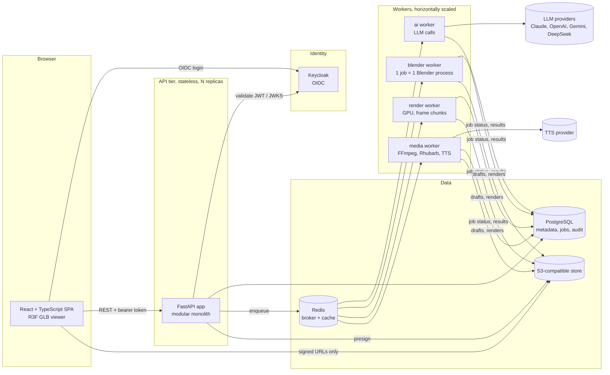
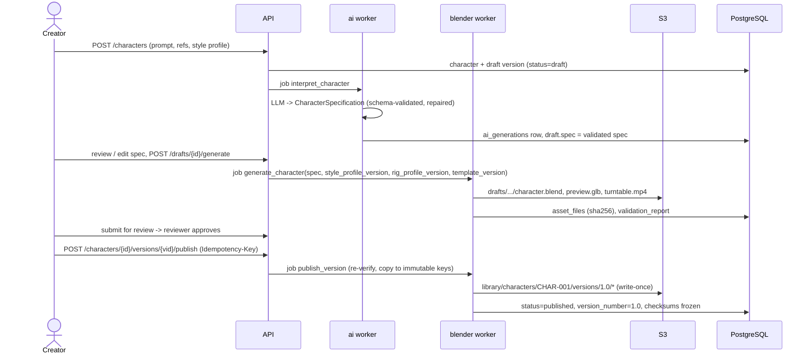
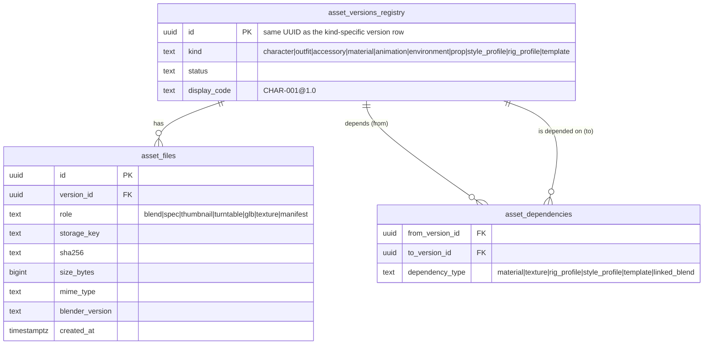
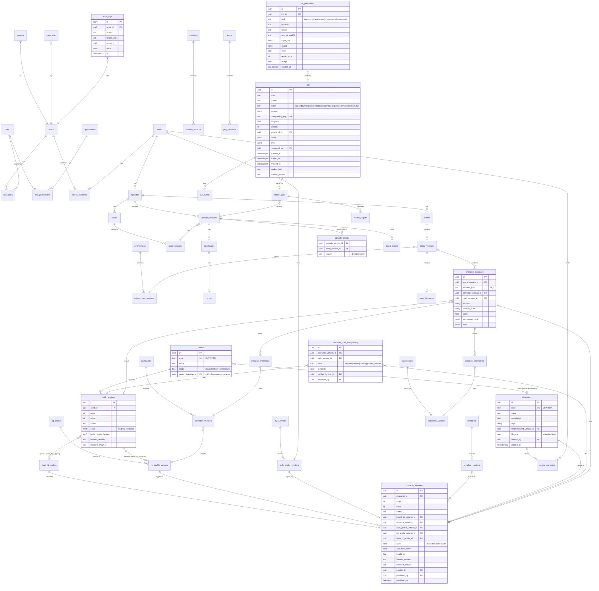
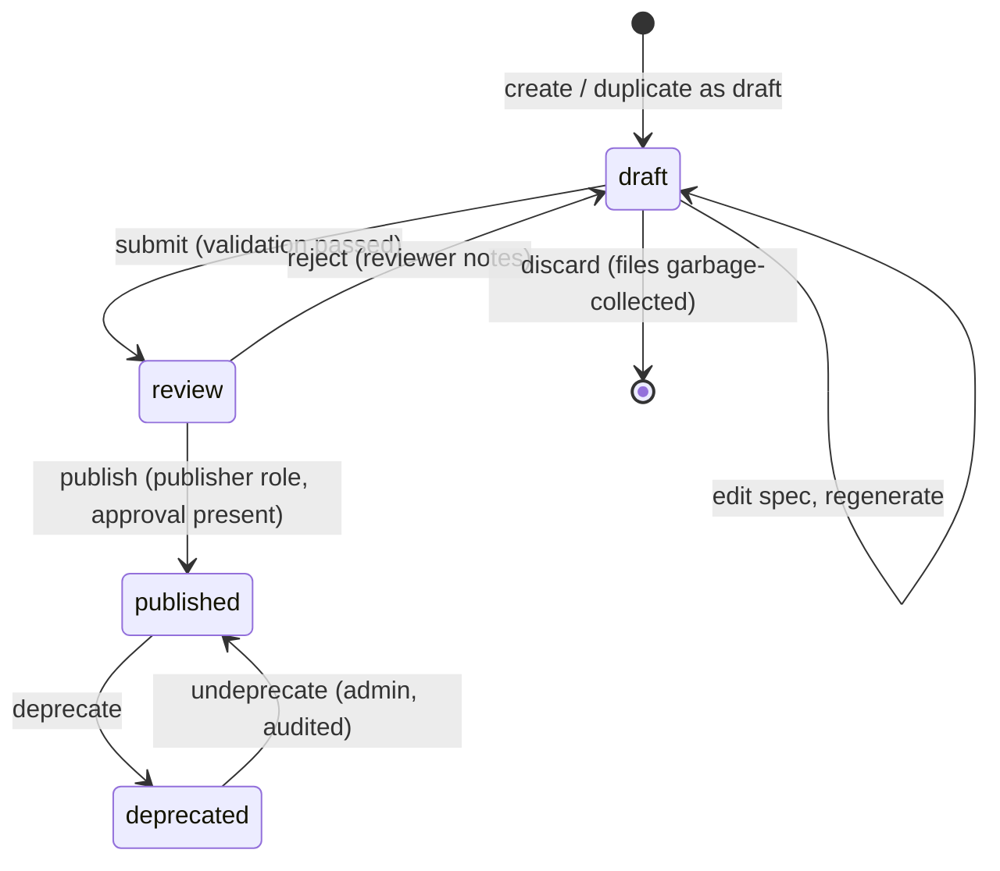
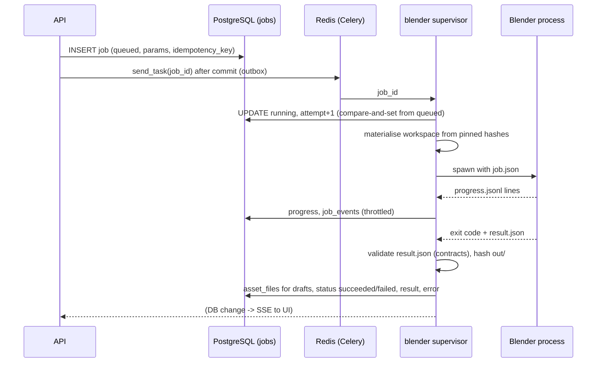
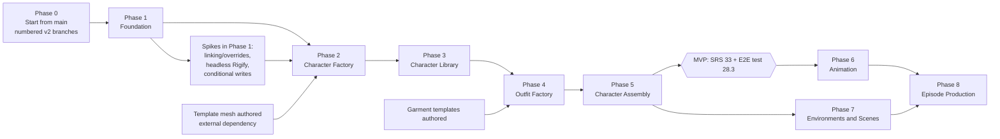

# AI-Assisted 3D Cartoon Production Platform: Technical Architecture

Status: **proposal for review** (SRS section 34, Task 1). No implementation code is part of
this change. Phase 1 starts only after the architecture is approved.

This document answers the sixteen items in SRS section 34 and SRS section 32 steps 1 to 3
(analyse the spec, name missing decisions and risks, propose the final architecture). It also
says how the code already in this repository (PRs #1 to #16) carries over into the new
platform, because most of it maps onto a module in the SRS and should not be thrown away.

Contents

0. [Summary of decisions](#0-summary-of-decisions)
1. [System architecture](#1-system-architecture)
2. [Repository and package structure](#2-repository-and-package-structure)
3. [Database ER diagram](#3-database-er-diagram)
4. [Character asset data model](#4-character-asset-data-model)
5. [Outfit asset data model](#5-outfit-asset-data-model)
6. [Versioning and immutability](#6-versioning-and-immutability)
7. [Blender asset loading and linking](#7-blender-asset-loading-and-linking)
8. [Character rig standard](#8-character-rig-standard)
9. [Outfit compatibility](#9-outfit-compatibility)
10. [Storage architecture](#10-storage-architecture)
11. [Background job architecture](#11-background-job-architecture)
12. [API endpoint specification](#12-api-endpoint-specification)
13. [Frontend screen structure](#13-frontend-screen-structure)
14. [Security model](#14-security-model)
15. [Development roadmap](#15-development-roadmap)
16. [Major technical risks](#16-major-technical-risks)
17. [Missing technical decisions (open questions)](#17-missing-technical-decisions-open-questions)
18. [Transition from the existing code](#18-transition-from-the-existing-code)
19. [Deviations from the SRS](#19-deviations-from-the-srs)

---

## 0. Summary of decisions

| # | Decision | Why |
|---|---|---|
| D1 | One modular monolith API (FastAPI) plus three worker kinds (AI, Blender, media). No microservices. | SRS 4. The Blender process is the only thing that genuinely needs isolation, and it gets it as a worker, not a service. |
| D2 | A small shared `contracts` package (Pydantic only) holds every specification and job envelope. The API, the workers and the Blender engine all import it; nothing else is shared. | The Blender engine must validate the same specs as the API but must never import FastAPI, SQLAlchemy or `bpy` into the wrong process (SRS 21). |
| D3 | Every reusable asset has two records: an **identity** (`characters`) and immutable **versions** (`character_versions`). The same pattern is used for outfits, accessories, materials, animations, environments, props, style profiles, rig profiles and scripts. | SRS 2.3, 6. One generic mechanism, tested once. |
| D4 | Immutability is enforced in three places: the service layer, PostgreSQL triggers, and write-once object storage keys that only the publisher identity can write. | SRS 2.3, 27. A bug in one layer must not be enough to overwrite a published asset. |
| D5 | The **scene manifest** (`scene_versions.manifest`, JSON validated by `contracts`) is the authoritative description of a scene. `scene.blend` is a build artifact derived from it. | SRS 2.5, 16.3. Reproducibility and "scene state never flows back into the character" both follow from this. |
| D6 | Scenes **link** published character and outfit `.blend` files and use **library overrides** for scene state. Append-with-provenance is the documented fallback, chosen by a Phase 1 spike. | SRS 16.2 "the source asset must remain unchanged". |
| D7 | Linked library paths are always relative to a per-job **workspace** whose layout is reconstructed from the manifest, never absolute. | SRS 19.2 "avoid fragile local absolute paths". |
| D8 | Rig standard `cartoon_humanoid_v1` is generated with **Rigify** from a fixed metarig, with a fixed deform-bone list, fixed shape-key names for expressions and visemes, and fixed body-mask vertex groups. | SRS 10. Rigify gives IK/FK and fingers for free; a fixed contract on top of it gives the compatibility guarantees. |
| D9 | Outfits are authored once per **body-fit profile** against a reference body, then fitted to a specific character version by Surface Deform plus weight transfer, then verified by a pose-suite intersection test. Compatibility is a registry row with a verification result, not a tag. | SRS 7.3, 7.4. |
| D10 | PostgreSQL `jobs` table is the source of truth for job state; Celery on Redis is only transport. One Blender process per job, killed on cancel or timeout. | SRS 18.2, 26. Celery's own state is lossy and Redis redelivers long tasks. |
| D11 | The character generator starts from a **hand-authored template mesh** per body family and makes it parametric (shape keys, bone landmarks, material parameters). It does not build topology from nothing. | SRS 5.3 asks for "professional quality". Procedural-from-scratch topology does not get there; a good template does. See risk R1. |
| D12 | The existing LLM provider adapter (`studio/llm`, PR #16) becomes the AI orchestration layer's provider interface unchanged; the six agents become AI tasks behind the API. | SRS 24 is already satisfied by that code. |

---

## 1. System architecture

### 1.1 Deployment view



### 1.2 Logical modules (SRS 4.2) and where each lives

| SRS module | Backend package | Blender engine package | Worker queue |
|---|---|---|---|
| 1 User and auth | `app.core.auth`, `app.identity` | none | none |
| 2 AI orchestration | `app.ai` (providers, tasks, logging) | none | `ai` |
| 3 Character Factory | `app.character` | `cartoon_engine.character`, `.rigging`, `.materials` | `blender` |
| 4 Character Library | `app.character` (library service), `app.assets` | none | `blender` (publish checks) |
| 5 Outfit Factory | `app.outfit` | `cartoon_engine.outfit` | `blender` |
| 6 Outfit Library | `app.outfit`, `app.assets` | none | none |
| 7 Accessory Library | `app.accessory` | `cartoon_engine.accessory` | `blender` |
| 8 Material Library | `app.material` | `cartoon_engine.materials` | `blender` |
| 9 Animation Library | `app.animation` | `cartoon_engine.animation` | `blender` |
| 10 Environment and Prop Factory | `app.environment` | `cartoon_engine.environment` | `blender` |
| 11 Scene Editor | `app.scene` | `cartoon_engine.scene` | `blender` |
| 12 Script and Storyboard | `app.story` | none | `ai` |
| 13 Episode Production | `app.production` | `cartoon_engine.scene` | all |
| 14 Rendering Manager | `app.rendering` | `cartoon_engine.rendering` | `render`, `media` |
| 15 Asset Storage Manager | `app.assets`, `app.core.storage` | `cartoon_engine.core.workspace` | none |
| 16 Preview and Export | `app.preview` | `cartoon_engine.export` (GLB, turntable) | `blender`, `media` |

Rule for module boundaries: a module may import another module's **service interface**
(`app.<module>.service`) and the shared `contracts`, never its repositories or ORM models.
The Character Library knows nothing about episodes; episodes reference character versions
by ID through `app.assets` (the generic version and dependency registry). An import-linter
contract in CI enforces this (Phase 1).

### 1.3 The production flow, end to end



AI only ever produces a specification (and drafts of scripts and shot plans). Every Blender
operation is deterministic code taking a validated spec. Publishing is a human action
(SRS 2.1, 24).

---

## 2. Repository and package structure

A single monorepo. The SRS layout in section 21 is kept, with one addition (`contracts/`)
and the Blender engine as a sibling installable package rather than a folder inside `app`.

```
animation-studio/
├── contracts/                      # shared, pure Pydantic, Python 3.13, no other deps
│   └── studio_contracts/
│       ├── ids.py                  # display codes (CHAR-001), version numbers
│       ├── character.py            # CharacterSpecification
│       ├── outfit.py               # OutfitSpecification
│       ├── accessory.py, material.py, animation.py, environment.py, prop.py
│       ├── style_profile.py        # StyleProfile
│       ├── rig_profile.py          # RigProfile (bone list, shape keys, masks)
│       ├── manifest.py             # AssetVersionManifest, SceneManifest, EpisodeManifest
│       ├── script.py, storyboard.py
│       └── jobs.py                 # JobEnvelope, JobResult, ProgressEvent, per-type params
│
├── backend/
│   ├── app/
│   │   ├── main.py, config.py
│   │   ├── api/v1/                 # routers only: characters.py, outfits.py, ... renders.py, jobs.py
│   │   ├── core/                   # auth.py, permissions.py, database.py, storage.py, logging.py, errors.py
│   │   ├── identity/               # users, roles, permissions, series membership
│   │   ├── assets/                 # generic identity/version/file/dependency registry, publisher
│   │   ├── character/              # factory.py, specification.py, validator.py, publisher.py, service.py
│   │   ├── outfit/                 # factory.py, specification.py, compatibility.py, publisher.py, service.py
│   │   ├── accessory/, material/, animation/, environment/, style/
│   │   ├── scene/, production/, story/, rendering/, preview/
│   │   ├── ai/                     # providers/ (from studio/llm), tasks/ (from studio/agents), log.py
│   │   ├── jobs/                   # job service, dispatcher, idempotency
│   │   ├── models/                 # SQLAlchemy ORM, one module per bounded context
│   │   ├── repositories/
│   │   └── schemas/                # API request/response models (wrap contracts)
│   ├── migrations/                 # Alembic
│   ├── tests/
│   └── pyproject.toml
│
├── blender_engine/                 # runs ONLY inside Blender's Python
│   ├── cartoon_engine/
│   │   ├── core/                   # workspace.py, blend_io.py, context.py, results.py, progress.py
│   │   ├── character/              # factory.py, geometry.py, face.py, hair.py
│   │   ├── rigging/                # metarig.py, rigify_gen.py, weights.py, profile_check.py
│   │   ├── materials/              # toon shaders driven by style profile
│   │   ├── outfit/                 # factory.py, fit.py, bind.py, masking.py
│   │   ├── accessory/
│   │   ├── animation/              # actions.py, retarget.py, procedural.py, lipsync.py
│   │   ├── environment/            # kits, generators (from tools/compose_env.py)
│   │   ├── scene/                  # assemble.py, link.py, overrides.py
│   │   ├── rendering/              # settings.py, turntable.py, render.py
│   │   ├── export/                 # glb.py, thumbnails.py
│   │   └── validate/               # mesh.py, rig.py, shape_keys.py, intersection.py, files.py
│   ├── entrypoints/run_job.py      # `blender -b --factory-startup -noaudio --python-exit-code 1 --python run_job.py -- job.json`
│   ├── templates/                  # source of hand-authored template .blend files (LFS)
│   └── tests/                      # run under Blender; CI uses the pinned Blender image
│
├── workers/
│   ├── studio_workers/
│   │   ├── celery_app.py
│   │   ├── ai.py                   # ai queue tasks
│   │   ├── blender.py              # launches and supervises Blender subprocesses
│   │   ├── render.py               # frame-chunk renders
│   │   └── media.py                # ffmpeg, rhubarb, tts
│   └── pyproject.toml
│
├── frontend/                       # Vite + React + TypeScript
│   └── src/ (app/, routes/, features/<module>/, components/, api/ (generated), viewer/)
│
├── infra/
│   ├── docker/                     # api.Dockerfile, worker.Dockerfile, blender-worker.Dockerfile, frontend.Dockerfile
│   ├── compose.yaml                # postgres, redis, minio, keycloak, api, workers, frontend
│   ├── keycloak/realm-export.json  # dev realm with the four roles
│   └── env/.env.example
│
└── docs/architecture/
```

Why the Blender engine is a separate package: it runs under Blender's bundled Python, has a
different dependency set (`bpy` and `contracts` only), a different Docker image (Blender
binary, GPU drivers for render workers) and its own test runner. It never imports `app`.
The worker that launches Blender passes a JSON job file in and reads a JSON result file
out; that file pair is the whole interface (SRS 25 "structured job results").

Version constraints to pin in Phase 1 lockfiles (exact patch versions chosen in Phase 1
and recorded in `docs/architecture/versions.md`):

| Component | Constraint | Note |
|---|---|---|
| Python | 3.13 everywhere | `contracts` must import under Blender's bundled Python. Blender 5.1 and 5.2 ship Python 3.13 (the `bpy` 5.x wheels on PyPI are `cp313`), so API, workers and engine share one interpreter version. |
| Blender | 5.2.3 LTS | Phase 1 runs and tests on the `bpy` 5.2.3 wheel; the worker image can also install the official binary pinned by SHA-256. Every asset version records the Blender version that wrote it. |
| FastAPI | 0.115 or later (Phase 1 runs 0.162) | |
| SQLAlchemy | 2.0.30 or later (Phase 1 runs 2.1) | sync sessions on psycopg 3 |
| Alembic | 1.13 or later (Phase 1 runs 1.20) | |
| PostgreSQL | 16 or 17 | |
| Celery | 5.4 or later (Phase 1 runs 5.6) | |
| Redis | 7.x | |
| Object store | any S3 API; SeaweedFS 4.50 in the dev stack | MinIO stopped publishing community Docker images in 2025. Garage was tried and ignores `If-None-Match`; SeaweedFS honours it on PutObject and CompleteMultipartUpload and supports per-bucket identity permissions (10.4) |
| Keycloak | 26.4 | |
| Node | 22 LTS | |
| React / TS | React 18 or 19, TypeScript 5.x | R3F major must match React major (v8 for 18, v9 for 19) |
| FFmpeg | 6 or 7 | |
| Rhubarb Lip Sync | 1.13 or later | |

---

## 3. Database ER diagram

### 3.1 Conventions

- Primary keys are UUIDv7 (time-ordered, index friendly). Human-facing display codes
  (`CHAR-001`, `OUTFIT-002`) are a separate unique column, allocated from a per-kind
  sequence and never reused.
- Version numbers are `major.minor` stored as two integers plus a generated text column,
  unique per asset.
- Every version table carries `status` (`draft`, `review`, `published`, `deprecated`),
  `created_by`, `created_at`, `published_by`, `published_at`, `based_on_version_id`.
- JSONB is used for the validated specification documents (`spec`), validation reports and
  render settings. Everything that is queried, joined or constrained (versions, profiles,
  compatibility, dependencies, instances) is relational.
- All foreign keys are explicit; every foreign key and every common filter has an index.

### 3.2 Generic asset pattern

The ten asset kinds share one shape. Rather than ten copies of the publish logic, the
service layer has one generic `AssetRegistry` over these tables, and `asset_files` and
`asset_dependencies` point at a version through a single `asset_version_ref`
(kind + version UUID) backed by a registry table so the foreign keys stay real.



### 3.3 Full model



Tables added to the SRS list in section 20, and why:

| Added table | Reason |
|---|---|
| `rig_profiles`, `rig_profile_versions` | SRS 10.3 needs a rig profile to be a versioned thing that characters, outfits and animations point at, not a string. |
| `body_fit_profiles` | SRS 7.3 names them; compatibility needs a key. |
| `templates`, `template_versions` | Decision D11: the base mesh a character was built from is a dependency that must be pinned for reproducibility. |
| `outfit_rig_support`, `outfit_fit_support` | SRS 7.3 "outfits must declare supported rig profiles and body-fit profiles". |
| `series_members`, `series_characters` | Series-scoped access and casting (SRS 13). |
| `prop_instances`, `instance_accessories`, `instance_animations` | SRS 16.3 instance fields that are references belong in rows. |
| `jobs`, `job_events` | SRS 26 asks every job to have status, progress, logs and errors; `render_jobs` becomes a detail table of `jobs`. |
| `ai_generations` | SRS 24 "maintain logs of AI-generated specifications and provider metadata". |
| `reviews`, `comments` | Review state and reviewer comments (SRS 3, Viewer/Reviewer). |
| `asset_versions_registry` | Lets `asset_files`, `asset_dependencies` and `episode_assets` use real foreign keys across ten version tables. |

`episode_assets` holds the **closure** of everything an episode version depends on,
computed when the episode version is frozen (direct pins from scenes plus every transitive
dependency: materials, textures, rig profile, template, style profile). It is what a
re-render downloads, and what a "where is this asset used" query reads.

---

## 4. Character asset data model

### 4.1 Layers

| Layer | Where | Mutable? |
|---|---|---|
| Identity (`characters`) | PostgreSQL | name, description, tags, recommended version: yes (audited). Code: never. |
| Version record (`character_versions`) | PostgreSQL | Only while `draft`. Frozen at `review` except status. |
| Specification (`spec`) | JSONB, also `character.json` in storage | Draft only. |
| Binary asset files | Object storage, listed in `asset_files` | Draft prefix: overwritten by regeneration. Published prefix: write-once. |
| Version manifest | `manifest.json` in storage, hash in `character_versions.manifest_sha256` | Written once at publish. |

### 4.2 `CharacterSpecification` (contracts)

Extends the SRS 5.2 example. Every enumerated field is a closed vocabulary owned by the
style profile and the template, so the AI cannot invent unsupported parameters (SRS 5.2):
the API builds the JSON schema sent to the LLM from the selected style profile version, and
validation rejects any value the template does not implement.

```jsonc
{
  "schema_version": "character_spec/1",
  "name": "Ali",
  "style_profile": { "id": "family_cartoon", "version": "1.0" },
  "template": { "id": "TPL-HUMANOID-CHILD", "version": "1.2" },   // chosen by code from body.age_appearance
  "rig_profile": { "id": "cartoon_humanoid", "version": "1.0" },   // implied by the template
  "body": {
    "age_appearance": "child",                 // enum from style profile
    "body_type": "average",                    // enum -> body_fit_profile child_average
    "height_m": 1.28,                          // clamped to style profile range for age
    "head_body_ratio": 0.34,                   // clamped
    "proportions": { "shoulder_width": 0.0, "leg_length": 0.1, "belly": -0.2 }   // template sliders, -1..1
  },
  "face": {
    "shape": "rounded", "eye_shape": "large_rounded", "eye_size": 0.3,
    "eye_color": "#5A3A1E", "nose": "small", "mouth": "friendly", "ears": "default",
    "sliders": { "brow_height": 0.1, "cheek_fullness": 0.4 }
  },
  "hair": { "asset": { "id": "HAIR-SHORT-01", "version": "1.0" }, "color": "#151010" },
  "materials": { "skin": { "preset": "warm_medium" }, "eyes": { "iris": "#5A3A1E" } },
  "preview_outfit": { "id": "OUTFIT-001", "version": "1.0" },     // preview only, never baked in
  "expressions": "rig_profile_default",        // or an explicit subset/intensity tuning
  "reference_images": ["upload:9f3c..."],      // storage keys of validated uploads
  "overrides": {}                              // advanced: only keys the template exposes
}
```

Changes from the existing `studio/schemas/characters.py` (PR #1, #5, #10): the outfit is no
longer part of the character (it was baked into the built file via `studio_outfit_id`),
story fields (`goal`, `arc`, `relationships`, `role`) move to the series/script side, and
the asset status union (`library`/`parametric`/`build_request`) is replaced by the version
lifecycle.

### 4.3 Character version files

```
library/characters/{character_uuid}/versions/{major}.{minor}/
  character.blend        authoritative production asset (rig, body, face, hair, materials; no outfit)
  character.json         the CharacterSpecification used to build it
  manifest.json          AssetVersionManifest: every file + sha256, dependencies, versions, publisher
  thumbnail.png
  turntable.mp4
  preview.glb            browser preview: DEF bones only, morph targets for expressions/visemes, Draco or meshopt compressed
  expressions.png        contact sheet of every expression
  validation.json        the report that gated publication
```

`manifest.json` (abridged):

```json
{
  "kind": "character",
  "code": "CHAR-001",
  "version": "1.0",
  "files": [{"role": "blend", "key": "character.blend", "sha256": "…", "size": 18734211, "mime": "application/x-blender"}],
  "dependencies": [
    {"kind": "template", "code": "TPL-HUMANOID-CHILD", "version": "1.2"},
    {"kind": "rig_profile", "code": "cartoon_humanoid", "version": "1.0"},
    {"kind": "style_profile", "code": "family_cartoon", "version": "1.0"},
    {"kind": "material", "code": "MAT-SKIN-TOON", "version": "2.0"},
    {"kind": "hair", "code": "HAIR-SHORT-01", "version": "1.0"}
  ],
  "rig_profile": "cartoon_humanoid@1.0",
  "body_fit_profile": "child_average",
  "shape_keys": {"expressions": ["expr_happy", "…"], "visemes": ["vis_AI", "…"]},
  "blender_version": "4.5.x",
  "engine_version": "cartoon_engine 0.3.0+git.abc1234",
  "published_by": "user:…", "published_at": "…"
}
```

Textures are packed into the `.blend` for characters (decision: characters are small and
self-contained is worth more than texture dedup). Shared library materials are linked from
their own versioned material files, which are listed as dependencies and pinned.

---

## 5. Outfit asset data model

### 5.1 `OutfitSpecification` (contracts)

```jsonc
{
  "schema_version": "outfit_spec/1",
  "name": "School Uniform",
  "scope": "character",                       // character | body_profile | multi
  "owner_character": "CHAR-001",              // when scope=character
  "style_profile": { "id": "family_cartoon", "version": "1.0" },
  "rig_profile": { "id": "cartoon_humanoid", "version": "1.0" },
  "fit_profiles": ["child_average", "child_slim"],
  "pieces": [
    {
      "slot": "upper",                        // upper|lower|footwear|headwear|gloves|outer|accessory
      "garment": { "id": "GARM-HOODIE-01", "version": "1.0" },   // garment template from the garment library
      "params": { "length": 0.2, "looseness": 0.4, "hood": true },
      "material": { "preset": "cotton_soft", "base_color": "#2E5AAC", "pattern": null }
    },
    { "slot": "lower", "garment": { "id": "GARM-TROUSERS-01", "version": "1.0" }, "material": { "preset": "twill", "base_color": "#777777" } },
    { "slot": "footwear", "garment": { "id": "GARM-SNEAKER-01", "version": "1.0" }, "material": { "preset": "canvas", "base_color": "#F2F2F2" } }
  ],
  "hides_body_regions": ["torso", "upper_arm", "thigh", "shin", "foot"],
  "cloth_sim": null                           // reserved; not in MVP
}
```

Outfits are assembled from **garment templates** (hand-authored, parametric, weighted to
the rig profile's deform bones at the reference body of each fit profile). This is the
same idea as the existing `library/garments/` and `tools/build_character.py`, made into
versioned assets and with real skin weights instead of a single carrying bone.

### 5.2 Outfit version files

```
library/outfits/{outfit_uuid}/versions/{major}.{minor}/
  outfit.blend          one collection "OUTFIT", meshes with Armature modifier targeting a placeholder rig object "RIG_TARGET"
  outfit.json           OutfitSpecification
  fits/{fit_profile}.blend   optional per-fit-profile variants when one mesh does not cover the range
  manifest.json
  thumbnail.png, preview.glb (worn by the profile's reference body)
```

Each garment mesh carries: vertex groups named exactly after the rig profile's deform
bones, custom properties `studio_slot`, `studio_hides`, `studio_fit_profile`, and an
attachment record for rigid pieces (`attach_bone`, local offset). The armature modifier
target is rebound at assembly time (section 7).

### 5.3 Accessories

Same pattern, smaller: `accessory.blend` with one object or collection, a named
attachment point (`attach_point` from the rig profile's list, e.g. `head_top`, `face_eyes`,
`hand_R_grip`, `back_center`, `wrist_L`), a local transform, and optional deformation
weights for soft accessories (a scarf). Multiple accessories per instance are rows in
`instance_accessories`.

---

## 6. Versioning and immutability

### 6.1 Lifecycle



- A version number is assigned **at publish**, not at draft creation. Drafts are
  identified by UUID only, so abandoned drafts never burn numbers.
- `major` must increase when the rig profile version, body-fit profile, or template family
  changes, because those break outfit and animation compatibility. Otherwise the publisher
  chooses minor (default) or major. The rule is enforced by the publisher service.
- "Edit a published character" = `POST /characters/{id}/drafts {based_on_version_id}`,
  which copies the spec into a new draft. The published version is never touched.
- `recommended_version_id` on the identity is what new scenes default to. It changes only
  by explicit action. Existing scenes never follow it (SRS 6.3).
- Deprecated versions stay loadable forever; deprecation only hides them from pickers and
  warns on new use.

### 6.2 Enforcement, layer by layer

| Layer | Mechanism |
|---|---|
| Service | `AssetRegistry.update_draft()` refuses unless `status = 'draft'`; publish runs in one transaction with `SELECT … FOR UPDATE` on the identity row. |
| Database | `BEFORE UPDATE` trigger on every `*_versions` table: if `OLD.status IN ('review','published','deprecated')`, only `status`, `published_*` and `deprecated_*` columns may change, and only along allowed transitions; `BEFORE DELETE` refuses for published/deprecated. `asset_files` rows for a published version cannot be updated or deleted. Unique `(asset_id, major, minor)`. |
| Storage | Published files live in their own **library bucket**. Only the publisher identity can write it, and it writes each key once with a conditional put (`If-None-Match: *`), so a second write is refused by the server even in a race. Every other identity (API, workers) has read-only access to it. Object Lock (governance mode) on the bucket where the store supports it. |
| Verification | Every load of a published file checks its SHA-256 against `asset_files` (the worker cache keys by hash). A nightly job re-hashes a sample and alarms on mismatch. |
| Tests | The SRS 28.3 end-to-end test, plus negative tests that try each layer directly (SQL update, storage put with a worker credential). |

### 6.3 Publishing as an idempotent job

`publish_version` takes an `Idempotency-Key`. It: locks the draft; re-runs validation on the
exact draft files; computes hashes; allocates the version number; copies files from the
draft prefix to the immutable prefix with conditional puts; writes `manifest.json`; flips
status and writes `asset_files` rows in one DB transaction; writes the audit log. A retry
after a crash finds either the completed version (returns it) or the partly copied objects
whose hashes match (continues). A failed publish leaves the version in `review` and never
creates a published row (SRS 26).

### 6.4 Episodes and scenes

Scene and episode versions follow the same lifecycle, with `locked` in place of
`published` for an episode version frozen for final render. A locked episode version owns
its `episode_assets` closure; re-rendering it uses only those pins. Script versions are
versioned the same way and AI dialogue is kept in `script_versions`, separate from the
scene (SRS 14).

### 6.5 Phase 3 implementation (character library)

What was built, and where it differs in detail from 6.1 to 6.3:

- **Tables.** `characters` (identity) and `character_versions`, whose primary key is also the
  `asset_versions_registry` id. Status and `major.minor` live only on the registry row, so
  the lifecycle rules of 0002 apply to every kind; `character_versions` holds the spec, the
  build record (spec and built digests, profile refs, validation report, job) and the review
  and publish record. Profiles and the template are built-in code in this release, stored as
  `id@version` refs, not foreign keys (migration 0005).
- **Database guards (0005).** In `review` only the review, manifest and publish columns of a
  version may change (the build is frozen for the reviewer). Published and deprecated
  versions may only gain `deprecated_at` and cannot be deleted. Character codes never change,
  and `recommended_version_id` must name a published version of the same character.
- **Submit gate.** A draft can go to review only when its last build was made from its current
  spec (`built_digest = spec_digest`), passed validation, has the required files, and its
  `validation.json` names the SHA-256 of that exact `character.blend`. Only the newest
  generate job requested for a draft is attached; an older one finishing later is ignored.
- **Publisher.** `publish_character` runs on its own `publish` queue in `worker-publisher`,
  the only service with the publisher storage identity (writes the library bucket, reads the
  work bucket, nothing else). It downloads every draft file checking its SHA-256, re-validates
  `character.blend` in a fresh Blender process with scripts disabled, then writes everything
  once under `library/characters/{uuid}/versions/{M}.{m}/` with `manifest.json` and
  `publish_validation.json`, and flips the status in one transaction with the file rows,
  manifest hash, publisher and audit entry. 6.3 described this as a `blender` queue job; it
  needs its own queue because no other worker identity may write the library.
- **Version numbers.** Computed from the latest published version: 1.0 first, otherwise a
  minor bump, or major when asked or when the template family, rig profile or body-fit profile
  changed (forced, whatever was asked). The number is claimed by writing
  `version.claim.json` once into its prefix, not by a database row, so a failed publish
  leaves nothing published, a resumed publish reuses its own claim, and a number that already
  holds another version's objects (an abandoned attempt) is skipped rather than reused.
- **Manifest.** A pure function of the frozen version (files and hashes, dependencies, refs,
  shape keys, both validations, approver), so a resumed publish writes identical bytes.
  It records the approver; the publishing user and time are in the database and audit log.
- **Loading.** `cartoon_engine.character.library.link_character` links a version's
  `CHAR_*` collection and makes an editable library override; two versions of one character
  link side by side from their own files and each passes the full validator through its
  override (`cartoon_engine.tools.load_check`).
- **Not yet.** Undeprecate (admin), the draft garbage collector, `/usage`, the nightly
  re-hash and the AI `interpret` route under a draft are not built; the AI job exists on its
  own (`interpret_character`). The publisher's Blender log is not uploaded (its identity
  cannot write the work bucket); a failed publish carries the log tail in the job error.

---

## 7. Blender asset loading and linking

### 7.1 The workspace

Every Blender job gets a fresh directory. The worker materialises exactly the pinned files
the job needs into a fixed layout, from a host-local read-only cache keyed by SHA-256:

```
/work/{job_id}/
  job.json                       JobEnvelope (contracts)
  result.json                    JobResult written by the engine
  progress.jsonl                 ProgressEvent lines
  assets/
    character/CHAR-001/1.0/character.blend
    outfit/OUTFIT-002/1.0/outfit.blend
    material/MAT-SKIN-TOON/2.0/material.blend
    environment/ENV-004/1.1/environment.blend
  scene/
    scene.blend                  links ../assets/... with relative paths (//../assets/...)
  out/                           everything the job produces; uploaded by the worker, not by Blender
```

Because every scene file links its libraries with paths relative to `scene/` into
`assets/<kind>/<code>/<version>/`, any worker can reopen any saved scene by rebuilding the
same layout from the scene manifest. No absolute paths exist in any stored file. A
validator (`validate/files.py`) fails a job whose output `.blend` references a path outside
the workspace or a library not listed in the manifest. Blender's own
`bpy.data.libraries[i].filepath` plus `reload()` is the escape hatch for remapping old files
if the layout ever changes.

Asset files are opened with `--factory-startup` and `--disable-autoexec` so no embedded
Python or driver expression from a file runs.

### 7.2 Assembling a character instance (SRS 16.2)

1. Read the scene manifest instance: character version, outfit version, accessories.
2. API side, before the job: check `character_outfit_compatibility` is `approved` for the
   pair (or `verified` with a director override, audited). Reject otherwise.
3. Engine: `bpy.data.libraries.load(path, link=True)` the character's `CHAR` collection;
   instance it; `override_hierarchy_create` so the rig pose, actions, shape-key values,
   custom properties and Mask modifiers become local overrides. Mesh data stays linked.
4. Link the outfit collection, create its override, set every garment's Armature modifier
   `object` to the overridden character rig, parent to it.
5. Add body masks: a Mask modifier (inverted vertex-group mode) on the overridden body for
   the outfit's `hides_body_regions` (vertex groups `mask_<region>` defined by the rig
   profile).
6. Attach accessories to their rig-profile attachment points (Child Of constraint or bone
   parenting on the override).
7. Assign actions (NLA strips for layering), expression track, viseme track.
8. Place, rotate, scale the instance root.
9. Save `scene/scene.blend`. Then re-hash every file under `assets/` and fail the job if any
   hash changed. This makes "the source asset remains unchanged" a checked post-condition,
   not a hope.

Everything scene-specific lives in overrides inside `scene.blend` and in the manifest. It
cannot flow back into the library because the library files are read-only on disk, linked
not appended, hash-verified, and the worker identity has no write access to published keys.

### 7.3 Phase 1 result, and the fallback

The Phase 1 spike (`blender_engine/spikes/link_override.py`, report in
`spikes/phase1-spikes.md`) showed link plus overrides working on Blender 5.2.3. The outfit's
Armature modifier was retargeted to the character's overridden rig, the garment deformed
with it, a body Mask modifier was added, a pose and a scene-local Action were kept, the
library paths stayed relative, and the scene reopened after its workspace was moved to
another directory. The source files' hashes did not change. Two rules came out of it:

- Never change a pose bone's `rotation_mode` in a scene. On reload the mode override can be
  applied after the rotation value and convert it away. The rig profile fixes rotation modes
  in the published character.
- New custom properties on an override are dropped on save. Instance metadata lives in the
  scene manifest (D5), not on Blender objects.

The fallback is kept in case a later Blender release regresses. It is: append the collection into the scene,
stamp every appended datablock with `studio_source = CHAR-001@1.0#sha256`, and keep the
same hash post-condition on the source. Pinning still holds (the manifest pins the
version); only the scene file gets larger and the "used in" link becomes metadata instead
of a Blender library. The rest of the architecture does not change.

### 7.4 Is `scene.blend` authoritative?

No (decision D5). The manifest is. `scene.blend` is rebuilt from the manifest when the
manifest changes and cached as a scene-version file. The open question Q4 is whether artists
will hand-edit scene files in desktop Blender; if they will, the platform needs a
check-in step that diffs the overrides back into the manifest, which is substantial work
and is not in the MVP.

---

## 8. Character rig standard

`cartoon_humanoid_v1` is a **rig profile version**, a contract document in `contracts`
plus a validator in `blender_engine/cartoon_engine/character/validate.py` (8.4). A character, outfit or
animation is compatible with a profile only if it passes the validator.

### 8.1 Body rig

- Generated with **Rigify** (bundled with Blender) from a fixed human metarig. Rigify
  supplies IK/FK switching, finger controls, head/neck, a torso pivot and root.
- The template carries the metarig. After the parametric body is shaped, the generator
  moves metarig bones to landmarks measured on the deformed mesh (shoulders, elbows,
  wrists, hips, knees, ankles, neck, head, finger joints), runs Rigify generation headless,
  and binds the mesh with weights transferred from the template's hand-painted weights
  (Data Transfer, nearest face interpolated), then normalises.
- Fixed names. Deform bones use Rigify's `DEF-*` names; the profile lists the exact set
  (about 60 bones with fingers). Animations key the control bones; GLB previews export
  the `DEF-*` bones only.
- Root at origin, Z up, Y forward (existing CONVENTIONS.md), metres, 24 fps, scale 1.
- The SRS says "evaluate Rigify vs custom". The proposal is Rigify for v1 because it is
  maintained, well understood by animators, and headless-generatable. The Phase 1 spike
  generated the stock human metarig headless in about 7 s (706 bones, 160 deform bones, all
  `DEF-` prefixed, IK/FK switches and finger controls present) after moving landmark bones.
  The call must not pin `active_object` with `temp_override`, because the generator makes
  the new rig active and asserts it. The stock metarig includes a face rig; the profile
  will drop it in favour of shape keys (8.2). A custom rig is the
  fallback if R5 (headless Rigify generation) fails, and would keep the same `DEF-*` and
  control names so the contract does not change.

### 8.2 Face

- Shape keys on the head mesh with fixed names (the existing seed library already uses
  shape keys for faces):
  - Expressions: `expr_neutral` (basis), `expr_happy`, `expr_sad`, `expr_angry`,
    `expr_surprised`, `expr_fearful`, `expr_confused`, `expr_excited`, `expr_laughing`,
    `expr_crying`, each split by region (`_brow`, `_eyes`, `_mouth`) so they can be combined
    and so visemes can take over the mouth.
  - Visemes: `vis_AI`, `vis_E`, `vis_O`, `vis_U`, `vis_FV`, `vis_L`, `vis_MBP`, `vis_WQ`,
    `vis_TH`, `vis_rest`.
  - Blinks and eye shapes: `eye_blink_L/R`, `eye_wide_L/R`, `eye_squint_L/R`.
- Each shape key is driven from a custom property on a face control bone (`face_ctrl`),
  so actions can key expressions and intensity (0..1) the same way as bones.
- Eyes: separate eye meshes on `DEF-eye.L/R` bones with an aim target bone `eye_target`
  for eye tracking.
- Mixing order (evaluated by drivers): expression brow and eyes; expression mouth scaled by
  `1 - viseme_weight`; visemes; blinks on top.

### 8.3 Profile contents (what the validator checks)

Bone list and hierarchy; control bone names; shape key names; `mask_<region>` vertex groups
on the body (`head`, `neck`, `torso`, `upper_arm`, `forearm`, `hand`, `thigh`, `shin`,
`foot`, left/right where relevant); attachment points (bones or empties) for accessories;
rest-pose tolerances; height range; the `face_ctrl` properties. The validator also checks
weights sum to 1, no unweighted deform vertices, no non-manifold or zero-area faces, scale 1,
and renders a pose-suite contact sheet for the reviewer.

### 8.4 Phase 2 implementation (stand-in template)

Q2 (who authors the template) is still open, so Phase 2 built the engine against a
procedural stand-in, `TPL-HUMANOID-STANDIN@0.1`, in `blender_engine/cartoon_engine/character/`.
It satisfies this rig standard and every interface the artist-made template will plug into,
but it is placeholder art, not the "professional quality" of R1. What differs from 8.1 to
8.3 and why:

- **Geometry** comes from code: skeleton landmarks (`skeleton.py`), a skin-modifier body,
  a skull shaped by face shape and sliders, and face parts (eyelids, brows, mouth) generated
  from a `FaceState`. Each shape key is the head rebuilt from one state, so the 43 keys
  have exactly the profile's names. An artist template replaces `body.py`/`head.py`; the
  landmarks, rig fitting, drivers, validator and previews stay.
- **Weights** are deterministic distance-to-bone weights (at most four influences,
  normalised, Rigify's split limb segments blended), not transferred from hand-painted
  template weights. The head, hair and eyes are rigid.
- **Facing**: the character faces -Y (Blender's front view, as Rigify's metarig does),
  its left side is +X (`.L`).
- **Rigify**: the metarig's own bone axes (`align_roll`) and connection flags must be kept
  when bones are moved; reconnecting `spine.004` makes the head rig fail ("bone position is
  disjoint"). Generation takes about 0.8 s once the face rig is removed (404 bones).
- **Drivers** are simple expressions (`p`, and `p * (1 - min(1, v0 + … + v9))` for mouth
  expressions), so they evaluate with auto-run scripts disabled. Setting an ID property
  from code does not tag the depsgraph; the validator tags the rig before evaluating.
- **Validator** (`validate.py`) checks structure (bones, controls, shape keys and drivers,
  weights, masks, transforms, modifiers, materials, height, symmetry) and motion (FK arm,
  IK leg, head turn, every face property, viseme override, eye tracking) on evaluated
  meshes. Not yet checked: non-manifold geometry (the eyelids and mouth are open shells by
  design) and a body pose-suite contact sheet.
- **Previews** render with Cycles on the CPU: Eevee needs EGL/GPU, which headless workers
  lack. MP4s are encoded by Blender's bundled FFmpeg through the sequencer (Blender 5 needs
  `image_settings.media_type = "VIDEO"`). The GLB has DEF joints only and the 43 morph
  targets, uncompressed (no Draco yet).
- **Blender 5 detail**: new shape keys are created at value 1.0, so the builder sets 0.

### 8.5 Existing code

The seed library's `rigify_human` is an 11-bone placeholder rig made of boxes
(`tools/make_seed_library.py`), not a Rigify rig. It is renamed `legacy_box_human_v0` in
the transition and used only as a test fixture. The retargeting code (PR #12,
`tools/retarget.py`) and bone maps (`mixamo_to_rigify_human.json`) carry over, re-targeted
at the real `DEF-*` names.

---

## 9. Outfit compatibility

### 9.1 Body-fit profiles

A body-fit profile (`child_slim`, `child_average`, `child_stocky`, `adult_slim`,
`adult_average`, …) is a reference body (a template shaped to the profile's mid-point) plus
measurement ranges (height, chest, waist, hip, shoulder width, limb lengths, head ratio).
At publish, a character version is measured and classified into exactly one profile; a
character outside every range gets no profile and only `scope=character` outfits.

### 9.2 Three ways an outfit fits

| Outfit scope | Authored against | Compatible with |
|---|---|---|
| `character` | that character version's body | that character (each later character version needs re-verification) |
| `body_profile` | the profile's reference body | every character version classified in that profile, after verification |
| `multi` | several profiles (per-profile fit files) | characters in any listed profile, after verification |

### 9.3 Fitting and verification job (`verify_fit`)

For a (character version, outfit version) pair:

1. Load the character and outfit (section 7) in a workspace.
2. If the character is not the authored reference body, fit each garment with a Surface
   Deform modifier bound to the reference body and evaluated on the character body, then
   transfer skin weights from the character body (Data Transfer), then normalise.
3. Run the rig profile's **pose suite** (about 12 poses: T, A, arms up, sit, crouch, walk
   contact and passing, run, reach, look left/right, twist).
4. In each pose, measure body-through-garment penetration with a BVH-tree overlap test
   (sampled body vertices inside garment volume beyond a tolerance, after masks), garment
   self-intersection, and stretch (edge length ratio).
5. Write a `fit_report` (per pose, per garment, worst values and a contact sheet) and set
   the registry row to `verified` or `failed`.
6. A reviewer approves (`approved`). Only approved pairs can be assigned in a scene.

The SRS's "test for obvious body intersections and clipping" becomes this report with
thresholds that live in the style profile.

### 9.4 Registry behaviour

- A new character version gets candidate rows for every outfit in its fit profile and its
  own character-specific outfits; verification jobs are queued automatically, approval is
  manual (batch approve in the UI).
- A new outfit version gets candidate rows for the characters in its declared profiles.
- Compatibility rows are never edited into a new meaning; revoking writes `revoked` and an
  audit entry. Existing scenes that pinned a revoked pair still load (pins are pins) but
  show a warning.

The existing build queue's "variant" routing (PR #14, rig type match and bounds within 40%)
was a heuristic version of this; it is replaced by measured verification.

---

## 10. Storage architecture

### 10.1 Buckets and prefixes

Two private buckets per environment. Splitting by bucket, not by prefix, means write-once can
be enforced with plain per-bucket credentials on any S3 store, including ones without
prefix-scoped policies (decided in Phase 1, see 10.4):

```
studio-library   (publisher writes once; API and workers read)
  library/{kind}/{asset_uuid}/versions/{major}.{minor}/...  immutable published versions
  uploads/accepted/{upload_uuid}                             immutable after acceptance
  exports/{episode_uuid}/{episode_version}/{export_uuid}.mp4

studio-work      (API and workers write; publisher reads)
  drafts/{kind}/{asset_uuid}/{draft_uuid}/...                mutable, GC'd
  jobs/{job_id}/attempt-{n}/out/...                          raw job outputs and logs
  uploads/quarantine/{upload_uuid}                           browser presigned PUT, scanned, then promoted
  series/{series_uuid}/episodes/{episode_uuid}/
      scripts/, storyboard/, scenes/{scene_uuid}/versions/{n}/scene.blend, audio/
  renders/{render_job_uuid}/frames/{shot}/####.png
  cache/                                                     derived previews, regenerable, lifecycle-expired
```

UUIDs in keys (not display codes) so a renamed code or a series move never moves objects;
`manifest.json` carries the human-readable codes.

### 10.2 Rules

- No large binary in PostgreSQL (SRS 19). Postgres holds keys, hashes, sizes, MIME types.
- The browser never sees credentials; it gets presigned GET URLs (short expiry, 5 to 15
  minutes) from the API after an authorisation check, and presigned PUTs only to
  `uploads/quarantine/`.
- Business logic talks to a `Storage` protocol (`put_immutable`, `put`, `get`, `presign_get`,
  `presign_put`, `head`, `copy_immutable`); one S3 implementation over `boto3` with an
  endpoint URL, so a local S3 server, AWS S3, R2 or Backblaze all work (SRS 29 "no AWS-specific
  assumptions").
- Drafts not touched for 30 days and not referenced by any review are garbage-collected by
  a scheduled job; published and accepted objects are never collected.
- Render frame sequences are kept until the export is accepted, then moved to cold storage
  class or deleted per series setting (open question Q9: retention).

### 10.3 Worker cache

Each worker host keeps a read-only local cache keyed by SHA-256 (`/cache/sha256/ab/cd/…`),
LRU-evicted by size. Materialising a workspace hardlinks (or copies) from the cache, so a
character used in 40 scenes downloads once per host. Every cache fill verifies the hash.

### 10.4 Conditional writes

Write-once relies on `If-None-Match: *` on `PutObject` and `CompleteMultipartUpload`. AWS
S3 supports it; in Phase 1 SeaweedFS 4.50 refused both second writes with
`PreconditionFailed` (tested in `backend/tests/test_storage.py`), while Garage 2.1 accepted
them, which ruled Garage out. `Storage.put_immutable` also checks with `HEAD` first, treats an
identical re-write as success (so an interrupted publish can resume), and raises
`ObjectExists` for different content. For a store without conditional writes,
`STUDIO_S3_CONDITIONAL_WRITES=false` falls back to `HEAD`-then-put, which is safe only
because publishing holds the identity row lock (weaker; avoid in production).

---

## 11. Background job architecture

### 11.1 Queues and workers

| Queue | Worker | Concurrency | Jobs |
|---|---|---|---|
| `ai` | Python worker | many per host | interpret_character, outfit_spec, script, storyboard, shot_plan, recommend_clips, continuity |
| `blender` | Python supervisor that spawns Blender | 1 Blender process per job; N jobs per host by CPU and RAM | generate_character, generate_outfit, verify_fit, publish_version, export_glb, turntable, assemble_scene, inspect_upload |
| `render` | same supervisor, GPU image | 1 per GPU | render_chunk (frame range of one shot) |
| `media` | Python worker with FFmpeg, Rhubarb | several | tts, lipsync, assemble_video, transcode_preview |

The SRS asks that unrelated jobs never share a Blender process (SRS 18.2); the supervisor
starts a fresh `blender -b --factory-startup --disable-autoexec -noaudio
--python-exit-code 1 --python run_job.py -- /work/{id}/job.json` per job, in its own
process group, with CPU, memory (cgroup) and wall-clock limits.

### 11.2 Lifecycle



- **Source of truth**: the `jobs` row. Celery results backend is disabled. The UI reads
  job status from the API, which reads Postgres; live updates are pushed with
  Server-Sent Events from the API (`GET /api/v1/jobs/{id}/events`), fed by Postgres
  `LISTEN/NOTIFY`.
- **Outbox**: the API commits the job row, then enqueues; a sweeper re-enqueues `queued`
  rows older than a threshold, so a crash between commit and send never loses a job.
- **Idempotency**: `jobs.idempotency_key` unique; the same key returns the existing job.
  Publish additionally relies on the unique version constraint (section 6.3).
- **Retries**: only job types marked `retry_safe` (all generation jobs write to a fresh
  draft path, so they are). `publish_version` is resumable rather than retried blindly.
  Exponential backoff, max 3 attempts; Blender crashes with a segfault count as retryable
  once.
- **Cancel**: `POST /jobs/{id}/cancel` sets `cancel_requested`; the supervisor polls the
  row and sends SIGTERM then SIGKILL to the process group; a queued job is skipped.
- **Timeouts**: per job type in config; on expiry the process group is killed and the job
  is `timed_out`.
- **Long tasks and Redis**: Celery on Redis redelivers unacknowledged tasks after
  `visibility_timeout` (one hour by default), which would double-run long renders. Mitigation:
  renders are split into frame-chunk child jobs well under the timeout, `visibility_timeout`
  is set above the longest allowed job, and the compare-and-set on `jobs.status` makes a
  duplicate delivery a no-op.
- **Results**: Blender never talks to the database or object storage. It writes `out/` and
  `result.json`; the supervisor validates and uploads. This keeps credentials out of the
  Blender process (section 14).
- **Logs**: Blender stdout/stderr captured to `out/blender.log`, uploaded, linked from the
  job; structured events in `job_events`.

### 11.3 Render pipeline (SRS 18.1)

`render_episode` (parent) → validate episode version closure → per scene `assemble_scene`
(if the cached scene.blend is stale) → per shot `render_chunk` × N (frame ranges, Eevee for
previews, Cycles for finals, settings from the style profile version) → `assemble_video`
(FFmpeg: PNG sequence to H.264 MP4 per shot, concat, AAC mix of dialogue, music, effects) →
`render_outputs` rows and an export record. Each render job records episode version, scene
versions, the asset closure hash, Blender version, engine version, render settings, times,
status, errors and output keys.

---

## 12. API endpoint specification

Conventions: base `/api/v1`; JSON; Pydantic request/response models generated into
OpenAPI; cursor pagination (`?limit=50&cursor=…`, response `{items, next_cursor}`);
filtering by query parameters (`?tag=child&status=published&series_id=…&q=ali`); errors as
RFC 9457 `application/problem+json` with a stable `code`; `Idempotency-Key` header on every
POST that creates jobs or publishes; `ETag` / `If-Match` on draft edits to stop lost updates;
long work returns `202 Accepted` with a job resource.

### 12.1 Assets (characters shown; outfits, accessories, materials, animations, environments, props, style profiles and rig profiles follow the same shape)

| Method and path | Purpose | Permission |
|---|---|---|
| `POST /characters` | create identity + first draft from prompt and/or structured fields | `asset.create` |
| `GET /characters` | gallery, search, filter | `asset.read` |
| `GET /characters/{id}` | identity, recommended version, counts | `asset.read` |
| `PATCH /characters/{id}` | name, description, tags, recommended version | `asset.edit_identity` |
| `GET /characters/{id}/versions` | version history (all statuses visible to caller) | `asset.read` |
| `GET /characters/{id}/versions/{vid}` | version record, spec, files, validation report | `asset.read` |
| `GET /characters/{id}/versions/{vid}/files/{role}` | 302 to presigned URL | `asset.read` |
| `GET /characters/{id}/versions/{vid}/usage` | scenes/episodes pinning it | `asset.read` |
| `POST /characters/{id}/drafts` | new draft `{based_on_version_id?}` | `asset.create` |
| `PATCH /characters/{id}/drafts/{did}` | edit spec (validated) | `asset.edit_draft` (owner or lead) |
| `POST /characters/{id}/drafts/{did}/interpret` | AI: prompt + refs → spec (job) | `asset.create`, `ai.use` |
| `POST /characters/{id}/drafts/{did}/generate` | Blender build (job) | `asset.create` |
| `POST /characters/{id}/drafts/{did}/previews` | turntable, expression sheet, GLB (job) | `asset.create` |
| `POST /characters/{id}/drafts/{did}/submit` | draft → review | `asset.submit` |
| `POST /characters/{id}/versions/{vid}/review` | `{decision: approve|reject, notes}` | `asset.review` |
| `POST /characters/{id}/versions/{vid}/publish` | review → published (job) `{bump: minor|major}` | `asset.publish` |
| `POST /characters/{id}/versions/{vid}/deprecate` | published → deprecated | `asset.publish` |
| `DELETE /characters/{id}/drafts/{did}` | discard draft | `asset.edit_draft` |

The SRS's `POST /characters/{id}/publish` becomes version-scoped
(`/versions/{vid}/publish`), because a character can have several versions in review.

### 12.2 Compatibility

| Method and path | Purpose |
|---|---|
| `GET /characters/{id}/versions/{vid}/outfits` | outfits with compatibility state for that version |
| `GET /characters/{id}/outfits` | shortcut for the recommended version (SRS) |
| `POST /characters/{id}/outfits/compatibility` | queue `verify_fit` for `{character_version_id, outfit_version_ids[]}` (SRS) |
| `GET /compatibility?character_version_id=&outfit_version_id=&state=` | registry search |
| `POST /compatibility/{cid}/approve`, `/revoke` | reviewer actions |
| `POST /outfits/{id}/versions/{vid}/try-on` | preview job on a chosen character version (no registry write) |

### 12.3 Series, episodes, scripts, scenes

| Method and path | Purpose |
|---|---|
| `POST /series`, `GET /series`, `GET/PATCH /series/{id}` | series, style profile version, settings |
| `POST /series/{id}/members`, `DELETE …/{user_id}` | series-scoped roles |
| `POST /series/{id}/cast`, `DELETE …/{character_id}` | main/supporting characters |
| `POST /episodes`, `GET /episodes?series_id=`, `GET/PATCH /episodes/{id}` | episodes |
| `POST /episodes/{id}/scripts/generate` | AI script from a concept (job) |
| `GET /episodes/{id}/scripts/versions`, `POST …/versions` | edited script versions |
| `POST /episodes/{id}/storyboards/generate`, `GET/PATCH /storyboards/{id}`, `/shots/{id}` | storyboard and shots |
| `POST /episodes/{id}/scenes`, `GET /scenes/{id}`, `GET /scenes/{id}/versions` | scenes (SRS) |
| `POST /scenes/{id}/versions` | new scene version from a manifest (validated: IDs exist, versions pinned, pairs approved) |
| `POST /scenes/{id}/versions/{vid}/assemble` | build scene.blend (job) |
| `POST /scenes/{id}/versions/{vid}/preview` | Eevee preview render (job) |
| `POST /episodes/{id}/versions` | freeze an episode version (computes the asset closure) |

### 12.4 Audio, rendering, jobs, uploads, admin

| Method and path | Purpose |
|---|---|
| `POST /uploads` | `{purpose, filename, size, mime}` → presigned PUT + upload id |
| `POST /uploads/{id}/complete` | trigger validation (job); becomes usable when accepted |
| `POST /audio`, `POST /audio/tts` (job), `POST /audio/{id}/lipsync` (job) | dialogue audio, TTS, visemes |
| `POST /render-jobs`, `GET /render-jobs?episode_id=`, `GET /render-jobs/{id}` | SRS |
| `POST /render-jobs/{id}/cancel`, `POST /render-jobs/{id}/retry` | SRS |
| `GET /render-jobs/{id}/outputs` | outputs with presigned URLs |
| `GET /jobs?type=&status=&mine=`, `GET /jobs/{id}`, `GET /jobs/{id}/events` (SSE), `GET /jobs/{id}/logs`, `POST /jobs/{id}/cancel` | generic job resource |
| `GET/POST/PATCH /admin/users`, `/admin/roles` | user and role management (mirrors Keycloak) |
| `GET/PUT /admin/ai-providers`, `GET /admin/ai-providers/test` | provider config (from PR #16) |
| `GET /admin/workers` | worker heartbeat, Blender version, queue depth |
| `GET /audit-logs` | audit search |
| `GET /health`, `GET /ready` | liveness, readiness (DB, Redis, storage) |

---

## 13. Frontend screen structure

Stack: Vite, React, TypeScript, React Router, TanStack Query, Tailwind, React Three Fiber
with drei for the GLB viewer, a client generated from the OpenAPI document
(`openapi-typescript` + a small fetch wrapper), `oidc-client-ts` for Keycloak login. The
SPA never touches Blender files or storage credentials; it receives presigned URLs from the
API.

```
/                                   Dashboard: my drafts, items awaiting my review, running jobs, recent renders
/characters                         Character Library: gallery, search, filters (tag, series, status, fit profile)
/characters/new                     Character creation: prompt, refs, structured controls, style profile, progress, preview
/characters/:id                     Detail: 3D viewer, version history, outfits (compat state), expressions, animations, usage
/characters/:id/drafts/:did         Draft editor: spec controls, regenerate, previews, validation report, submit
/characters/:id/versions/:vid       Read-only version view: publish / deprecate / duplicate as draft
/outfits, /outfits/new, /outfits/:id, /outfits/:id/drafts/:did   Outfit Library and editor; try-on on a character
/compatibility                      Review queue for verified fit reports (batch approve)
/accessories, /animations, /materials, /environments, /props     Libraries with the same gallery/detail/draft pattern
/style-profiles, /rig-profiles      Admin-level libraries
/series, /series/:id                Series: cast, style profile, members, episodes
/episodes/:id                       Episode editor (Phase 8): script, storyboard, scenes, characters, outfits, dialogue
/episodes/:id/scenes/:sid           Scene editor: viewport, timeline, camera, animation, dialogue, preview render
/queue                              Production queue: all jobs, filters, logs, cancel/retry
/renders, /renders/:id              Render manager: progress by shot and chunk, outputs, player
/reviews                            Everything awaiting review, comments
/settings                           Profile; admin: users, roles, AI providers, workers, storage, audit log
```

Shared components: `AssetGallery`, `VersionTimeline` (status chips, "based on" graph),
`SpecForm` (generated from the JSON schema of the spec and the style profile's
vocabularies, so the form and the AI see the same constraints), `GlbViewer` (orbit, pan,
zoom, front/side/back buttons, expression and viseme sliders driving morph targets,
animation clip picker, outfit toggle), `JobProgress` (SSE), `ValidationReport`,
`FitReport`, `ReviewPanel`. Published versions render read-only everywhere; the only
action is "Duplicate as draft" (SRS 22.2).

The current dependency-free GUI (PR #15, `studio/gui/`) informs the review screens: its
gate view (output + Approve / Revise with notes / Edit JSON) is the same interaction as
`ReviewPanel`, and its build-queue and library views map onto `/queue` and the library
galleries.

---

## 14. Security model

| Concern | Design |
|---|---|
| Authentication | Keycloak realm, OIDC Authorization Code + PKCE for the SPA; API validates JWTs against the realm JWKS (issuer, audience, expiry). Service accounts (client credentials) for workers. Dev compose ships a realm export with test users. |
| Authorisation | Roles from the SRS (`admin`, `creator`, `director`, `reviewer`) map to permission sets stored in `roles` / `permissions` / `role_permissions`. Global roles come from Keycloak; series-scoped roles from `series_members` (open question Q6). One `require(permission, resource)` dependency on every route; deny by default; unit tests per permission (SRS 28.1). |
| Separation of duties | `asset.publish` requires an approved review by someone other than the draft's creator unless the series setting allows self-approval (small team). |
| AI cannot publish | AI tasks run with a service identity that has no `asset.publish`, `asset.review` or storage publish rights (SRS 24). |
| Uploads | Presigned PUT to quarantine only, with size cap and content-type condition. `inspect_upload` job checks magic bytes, re-encodes images with Pillow (strips metadata and payloads), rejects SVG/HTML. User-supplied `.blend`, FBX and GLB files open only in a Blender worker with `--disable-autoexec`, no network, and no credentials. |
| Storage access | Both buckets private. Three identities: API (read both, write work for presigned uploads), workers (read library, write work), publisher (the only identity that can write the library bucket, conditional puts only; read-only on work). Phase 1 tests each refusal against SeaweedFS. No public URLs; presigned GETs are short-lived and issued after a permission check. |
| Worker isolation | Blender runs as an unprivileged user in a container with a read-only root FS, its workspace as the only writable mount, cgroup CPU/RAM limits and no outbound network for `blender` and `render` queues. LLM-written bpy (the existing Asset Builder, PR #13) runs only in that sandbox with its existing static allow-list as a second layer. |
| Secrets | Env vars from the deployment secret store; nothing in the repo. LLM provider keys set through the admin UI are stored encrypted (envelope encryption, key from the secret store) and only the `ai` worker can decrypt them. |
| Input validation | Pydantic on every request; specs validated against contracts and the style profile vocabulary; IDs referenced in scripts/manifests checked to exist and be visible to the caller. |
| Audit | Append-only `audit_logs` (no UPDATE/DELETE grants) for login, role change, publish, deprecate, approve, compatibility change, provider config, downloads of production files. |
| Transport | TLS everywhere outside localhost; CORS restricted to the SPA origin; CSRF not applicable to bearer tokens (no cookies for API auth). |

---

## 15. Development roadmap

### 15.1 Phases and dependencies



| Phase | Delivers | Depends on | Reuses from PRs #1 to #16 | Acceptance (demonstrated by running it) |
|---|---|---|---|---|
| 0 Start | New work branches from `main` as a numbered stack (`v2-01-architecture`, `v2-02-…`); the 16-PR stack stays on its own branches as the reference implementation | M's go-ahead | none | the stack builds from `main` alone |
| 1 Foundation | Monorepo layout, compose (Postgres, Redis, S3 server, Keycloak, API, workers), FastAPI skeleton with auth, Alembic baseline (identity, jobs, asset registry tables), storage protocol, Blender worker image with pinned Blender, job supervisor, `ping_blender` job that saves a `.blend` to storage, the three spikes | Q1 (Blender version) | `studio/llm` moved to `app/ai/providers`; `tools/asset_builder/sandbox.py` patterns for the supervisor | SRS 30 Phase 1 criteria; spike reports in `docs/architecture/spikes/` |
| 2 Character Factory | `CharacterSpecification`, one humanoid template (child) with sliders, face, hair pieces, toon materials from the style profile, Rigify rig per section 8, facial shape keys and drivers, validators, turntable, GLB export, `interpret_character` AI task | Phase 1, template asset | `tools/build_character.py` (slider mapping, material slots), `tools/turntable.py`, Character Designer prompt (rewritten), `structured.py` repair loop | SRS 30 Phase 2 criteria |
| 3 Character Library | identity/version tables, lifecycle, immutability triggers, publisher job, manifests, SHA-256, gallery, detail page, GLB viewer, version history | Phase 2 | `RunStore` versioning ideas, GUI gate interaction | SRS 30 Phase 3 criteria + negative immutability tests |
| 4 Outfit Factory | `OutfitSpecification`, three garment templates (top, bottom, shoes) per fit profile, fit/bind, masks, `verify_fit`, compatibility registry, outfit library UI | Phase 3, garment templates | `library/garments` conventions, `_attach` logic in `build_character.py` | SRS 30 Phase 4 criteria |
| 5 Character Assembly | scene manifest (MVP subset), workspace materialiser, link + override assembly, accessories, expression controls, animation assignment, source-hash post-condition | Phase 4 | Layout TD's code-owned staging ideas | SRS 30 Phase 5 criteria and the **SRS 28.3 end-to-end test** (MVP gate) |
| 6 Animation | animation library, rig compatibility, retarget pipeline onto `DEF-*`, locomotion and talk clips, procedural layers, Rhubarb lip sync | MVP | `tools/retarget.py`, `tag_clips.py`, `procedural.py`, `studio/assets/clips.py`, bone maps | SRS 30 Phase 6 criteria |
| 7 Environments and Scenes | environment and prop factories, kits, generators, scene assembly with two characters, cameras, lighting presets, preview render | Phase 5 (Phase 6 for animated previews) | `tools/compose_env.py`, kits/generators, `lighting_presets.json`, Asset Builder + Render QA loop for props, build-queue routing | SRS 30 Phase 7 criteria |
| 8 Episode Production | series, script and storyboard engine, shot planning, dialogue, TTS, render pipeline, FFmpeg export, episode versions with asset closure | Phases 6, 7 | Story Analyst, Scene Builder, Director, Layout TD, Continuity Checker, coordinator gates and fix loop, exports, `checks.py` cross-reference checks | SRS 30 Phase 8 criteria |

Every phase ends with a recorded demonstration (commands, outputs, screenshots) checked in
under `docs/demos/phase-N.md`, per SRS 31 "do not mark a phase complete merely because code
has been generated".

### 15.2 Phase 1 in more detail (what approval would start)

1. Each step below is its own numbered branch on top of the previous one.
2. `infra/compose.yaml` with Postgres, Redis, an S3 server (bucket and policies created by an init
   container), Keycloak (realm import), API, `ai`/`blender`/`media` workers.
3. FastAPI app: config (pydantic-settings), structured logging (JSON), problem+json errors,
   health/ready, JWT validation, `require(permission)`.
4. Alembic baseline: users/roles/permissions, `asset_versions_registry`, `asset_files`,
   `jobs`, `job_events`, `audit_logs`, immutability trigger function (tested).
5. Storage protocol and S3 implementation with conditional put; tests against a real S3-compatible server.
6. Blender worker image: pinned Blender tarball (checksum-verified), `contracts` installed
   into Blender's Python, `run_job.py` entrypoint, supervisor with timeouts, cancel and
   progress.
7. Job `blender_smoke`: create a mesh, save `.blend`, upload to drafts, record
   `asset_files`; `GET /jobs/{id}` and `GET /assets/files/{id}` return the metadata.
8. Spikes with written results: (a) link + override + armature-modifier retarget + Mask
   modifier on the pinned Blender; (b) headless Rigify generation from a metarig;
   (c) conditional writes on the local S3 server and the target cloud store.
9. CI: lint, type check, unit tests, migration up/down, Blender integration tests in the
   Blender image.

---

## 16. Major technical risks

| # | Risk | Likelihood / impact | Mitigation |
|---|---|---|---|
| R1 | **Character quality.** Procedural generation alone will not reach "professional-quality stylized" characters; the SRS's quality bar depends on the template mesh more than on code. | High / high | D11: commission or author one excellent child template (clean quad topology, face loops for expressions, UVs, sculpted expression and viseme shapes, painted weights) before Phase 2; parametric code varies it within ranges that stay on-model. Budget this as an art task, not a coding task. |
| R2 | **Variety from one template.** Sliders on one mesh produce siblings, not a cast. | High / medium | Several head/face blend shapes per template, swappable hair/ear/nose parts with defined seams, a second template (adult) in Phase 2b. |
| R3 | **Garment fit across bodies.** Surface Deform fitting can stretch, and clipping in extreme poses is common. | High / high | Fit profiles keep the range narrow; body masks hide what is under clothing; the pose-suite report makes failures visible; character-specific outfits as the escape hatch. |
| R4 | **Library overrides** are complex and have had regressions between Blender releases (pointer overrides on modifiers, re-sync after library changes). | Medium / high | **Phase 1 spike passed on 5.2.3** (7.3), and it runs as a regression test on every Blender upgrade. Immutable library files mean overrides never need resyncing to a changed source. Append-with-provenance stays as the fallback. |
| R5 | **Headless Rigify generation** uses operators that expect a UI context. | Medium / medium | **Phase 1 spike passed on 5.2.3** (8.1), and it runs as a regression test. The fallback is still a rig generated once per template offline, or a custom rig with the same names. |
| R6 | **Blender version drift.** `.blend` files are forward compatible only in practice, and Python API changes break the engine. | Medium / high | One pinned LTS; Blender version recorded per asset version and per job; upgrade is a planned migration with a re-validation job across the library; never mix versions in one render. |
| R7 | **Reproducibility is not bit-exactness.** GPU, driver and Cycles sampling differences change pixels. | Certain / low | Define reproducible as "same pinned inputs, same Blender and engine version, same settings, fixed seeds"; record all of them; compare re-renders by perceptual difference, not hashes. |
| R8 | **Celery + Redis redelivery** of long tasks after `visibility_timeout`. | High if ignored / medium | Chunked renders, raised timeout, compare-and-set on job status (11.2). |
| R9 | **LLM output drift and provider differences** (DeepSeek's 8192-token cap, non-strict JSON for some providers). | Medium / low | Existing repair loop (PR #16), vocabularies from the style profile in the schema, all output validated, every generation logged with provider/model, and specs are always human-reviewable before generation. |
| R10 | **Lip-sync mapping.** Rhubarb outputs Preston Blair shapes A to H and X; the SRS list includes TH and W/Q, which Rhubarb does not distinguish. | Certain / low | Map Rhubarb shapes onto the SRS visemes (A→MBP, B→E/consonant, C→E, D→AI, E→O, F→U/WQ, G→FV, H→L, X→rest); keep `vis_TH` for manual keys or a phoneme-level tool later; editable viseme track in the UI. |
| R11 | **GPU rendering capacity and cost** are unknown and dominate Phase 8. | Medium / high | Eevee for everything until a shot needs Cycles; benchmark in Phase 7; render queue is separate so GPU hosts scale independently (Q8). |
| R12 | **Storage growth** from frame sequences and draft churn. | High / medium | Draft GC, frame retention policy, lifecycle rules, dedup cache by hash. |
| R13 | **Scope.** The SRS describes a multi-year studio platform. | Certain / high | The MVP gate (Phase 5 + E2E test) is the only commitment before reassessing; Phases 6 to 8 are re-planned after it. |
| R14 | **Untrusted Blender files** (uploads, LLM-written scripts) can run code via drivers or embedded scripts. | Medium / high | `--disable-autoexec`, sandboxed workers without network or credentials, static script checks retained from PR #13. |
| R15 | **Mocap licensing.** The existing pipeline retargets Mixamo/CMU clips; Mixamo's terms restrict redistributing the raw files. | Medium / medium | Keep `LICENCES.md` provenance per clip (already in PR #12), store only baked derived actions, legal check before series release. |
| R16 | **Small team, heavy infra.** Keycloak, Celery, Redis, an S3 server and Postgres for a handful of users is a lot to operate. | Medium / medium | Compose for everything locally; one-host deployment target first; Keycloak could be swapped for a hosted OIDC provider without code change (Q7). |

---

## 17. Missing technical decisions (open questions)

These are the decisions the SRS leaves open that change the design. Each has a proposed
default that the plan above assumes; the ones marked ★ are worth M's explicit answer before
Phase 1 starts.

| # | Question | Proposed default |
|---|---|---|
| Q1 | Which Blender release do we pin? | **Decided in Phase 1:** 5.2.3 LTS, the current LTS, which the spikes verified. Every later upgrade is a planned migration that reruns the spike tests. |
| Q2 ★ | Who authors the first character template and the first garment templates (R1)? | A commissioned or in-house 3D artist delivers one child template and three garments to the rig standard in section 8 before Phase 2; the engine work starts in parallel on a simplified stand-in. **Still open.** Phase 2 shipped on the procedural stand-in `TPL-HUMANOID-STANDIN@0.1` (8.4). |
| Q3 | Do we merge the existing 16-PR stack into `main` first? | **Answered by M:** no. The new platform starts from `main` on its own numbered branches; the stack stays unmerged as a reference, and code is ported from it when a phase needs it. |
| Q4 ★ | Will artists hand-edit scene or character files in desktop Blender? | Not in the MVP. Character edits go through draft specs; scene edits through the scene manifest. A desktop check-in workflow is a later phase. |
| Q5 | How is a reference image used? | As vision input to the AI interpretation step only (spec suggestions). No image-to-3D in the MVP; the queue keeps the `image_to_3d` route from PR #14 as a later option. |
| Q6 | Are roles global or per series? | Global roles plus optional per-series membership that restricts visibility and grants director/reviewer on that series. |
| Q7 | Keycloak or a hosted OIDC provider? | Keycloak in compose for dev and self-hosting; the API only depends on OIDC, so a hosted provider is a config change. |
| Q8 | Where does rendering run (local GPUs, cloud GPUs, a render service)? | Undecided until Phase 7 benchmarks; the render queue is designed to run anywhere a container with the pinned Blender and a GPU runs. |
| Q9 | Retention for frame sequences and drafts? | Drafts 30 days after last touch; frames until the export is accepted plus 14 days; exports and published assets forever. |
| Q10 | Version bump rules: who decides major vs minor? | Enforced major on rig/body/template change; otherwise the publisher chooses, default minor. |
| Q11 | Self-approval for a one-person team? | Allowed per series setting, audited; off by default. |
| Q12 | Hair technique? | Stylised mesh hair pieces (cards/shells) from a hair library, not particle or curve hair, for GLB previews and Eevee speed. Curve hair later if the style needs it. |
| Q13 | Cloth simulation? | Out of scope until after Phase 8; outfits are skinned only. |
| Q14 | Which TTS provider, and how is voice consistency defined? | Provider-independent `VoiceProvider` interface like the LLM one; a character version has an optional `voice_profile` (provider, voice id, settings) pinned in the episode. Provider choice deferred to Phase 8. |
| Q15 | Is the API async (asyncpg) or sync? | Sync SQLAlchemy sessions in a threadpool for simplicity; async only where SSE needs it. |
| Q16 | Display code format: `CHAR-001` or the existing `char_mia` slugs? | `CHAR-001` display codes per the SRS, with a `slug` column so legacy `char_*` IDs keep resolving during transition. |
| Q17 | How many series and users in year one? | A handful of users, one or two series; this sizes Postgres and Redis at single instances. |

---

## 18. Transition from the existing code

### 18.1 What exists

Sixteen stacked, unmerged PRs (#1 to #16; about 12,000 lines of Python, 113 tests passing,
1 failing, 9 skipped because the `bpy` wheel is absent in CI). The system they build is a
**story-first** pipeline: a story goes in, six agents produce story bible, character
sheets, world, direction and layout, gated by human approvals, and deterministic Blender
tools build characters, environments, clips and props into a file-based library scanned
into `manifest.json`.

The SRS is **library-first**: characters, outfits and assets are permanent versioned
products, and episodes cast them. That is the main change in direction. The existing work
maps onto it well, but the Character Designer can no longer invent a new character per story
(SRS 2.2); it casts from the library or opens a character request.

### 18.2 Mapping

| Existing (PR) | Becomes | Change |
|---|---|---|
| `studio/llm` (#16): provider adapter, registry, structured output with repair, per-agent model choice | `backend/app/ai/providers` | Kept almost as-is. This already satisfies SRS 24's provider-independent layer. Adds: config from the admin UI (encrypted keys), `ai_generations` logging, per-task model selection instead of per-agent. |
| `studio/agents/base.py` and the six agents (#4 to #9) | `backend/app/ai/tasks` | Story Analyst → episode concept to script (Phase 8). Character Designer → `interpret_character` (Phase 2, new prompt and output model). Scene Builder + Director + Layout TD → storyboard and shot planning (Phase 8). Continuity Checker → episode validation task. |
| `studio/agents/asset_builder.py`, `render_qa.py`, `tools/asset_builder/sandbox.py` (#13) | Prop factory (Phase 7) and the sandbox pattern for every Blender job | The subprocess-with-timeout runner is the seed of the Blender supervisor (Phase 1). |
| `studio/coordinator` (#2): ordered runner, gates, fix loop, merge, exports | Phase 8 episode orchestration as Celery chains; gates become `reviews` | The approval interaction (approve, revise with notes, edit JSON) is kept in the UI. File-based `RunStore` is replaced by `script_versions`, `storyboards`, `shots`. |
| `studio/schemas` (#1) and `studio/checks.py` | `contracts` (new specs) + episode validators | Story bible, direction, layout schemas carry over to Phase 8 script/storyboard contracts. Character schema is replaced (section 4.2). Cross-reference checks become manifest validation. |
| `studio/ids.py` | `contracts/ids.py` | Display codes added; old slug patterns kept for legacy lookups. |
| `tools/blend_common.py`, `scan_library.py`, `lint_library.py` (#3) | `cartoon_engine.core`, `cartoon_engine.validate` | The scanner's metadata extraction becomes the publish-time inspection job; `manifest.json` is replaced by the database. |
| `tools/build_character.py` (#10) | `cartoon_engine.character` | Slider mapping, height scaling and material-slot logic carry over. Outfit baking is removed (outfits are separate assets); rigid bone parenting is replaced by real skinning and Rigify. |
| `tools/compose_env.py` (#11), kits, generators, `lighting_presets.json` | `cartoon_engine.environment` (Phase 7) | Mostly kept; outputs become versioned environment assets. |
| `tools/retarget.py`, `tag_clips.py`, `procedural.py`, `studio/assets/clips.py`, bone maps (#12) | `cartoon_engine.animation` (Phase 6) | Retargeted onto `cartoon_humanoid_v1` `DEF-*` bones. |
| `studio/assets/queue.py` (#14) | Asset request backlog (Phase 7/8) | Screen-time ranking and routing kept; variant heuristic replaced by compatibility verification. |
| `studio/gui` (#15) | Retired when the React app covers its screens (Phase 3 for the library, Phase 8 for runs) | Its screens are the reference for review and queue UX. |
| `studio/cli.py` | Developer CLI calling the API | Kept for scripting and tests. |
| `library/` seed `.blend` files | Test fixtures | Box placeholders; the `rigify_human` 11-bone rig is renamed `legacy_box_human_v0`. |

### 18.3 How

Decided by M: the new platform starts from `main` (which holds only the project scaffold)
on its own numbered branch stack, `v2-01-architecture`, `v2-02-…`, each built on the one
before, the same way PRs #1 to #16 were built. Nothing from the old stack is merged first.
When a phase needs a piece of the old code (the LLM providers in Phase 2, the retargeter in
Phase 6, the agents in Phase 8), it is copied from its branch into the new package with its
tests, adapted, and the branch it came from is named in the commit. The old stack stays
untouched as the reference implementation until M decides what to do with those PRs.

---

## 19. Deviations from the SRS

Per SRS 32.20 these need approval because they differ from the text, even if slightly.

| SRS | This proposal | Reason |
|---|---|---|
| 21: `blender_engine/` and `workers/` inside `backend/` | Top-level `blender_engine/`, `workers/`, plus a shared `contracts/` | Different runtime, image and dependency set; the shared contracts let the engine validate specs without importing the API. |
| 23: `POST /characters/{id}/publish` | `POST /characters/{id}/versions/{vid}/publish` | Several versions can be in review at once; publishing must name one. The SRS path can stay as an alias that publishes the single version in review. |
| 20: entity list | Adds rig profiles, body-fit profiles, templates, jobs, job events, AI generations, reviews, comments, series members, instance link tables, a version registry | Needed by requirements elsewhere in the SRS (sections 7.3, 10.3, 24, 26, 3). |
| 6.2: version folder per character `CHAR-001/versions/1.0/` | Same layout keyed by UUID (`characters/{uuid}/versions/1.0/`), display code in the manifest | Codes are human-facing and could be renumbered; storage keys must never move. |
| 5.3: procedural mesh generation | Parametric variation of hand-authored templates | Quality (R1). Procedural operations still do all variation, so the pipeline stays deterministic and AI-independent. |
| 18 "Do not execute unrelated concurrent production jobs in one shared Blender process" | Satisfied; additionally, related jobs also get their own process | Simpler and safer. |
