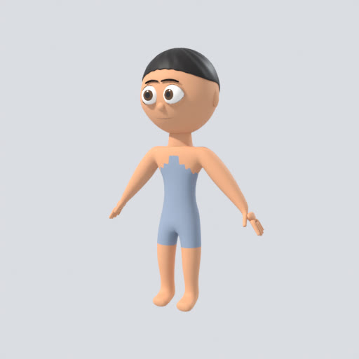
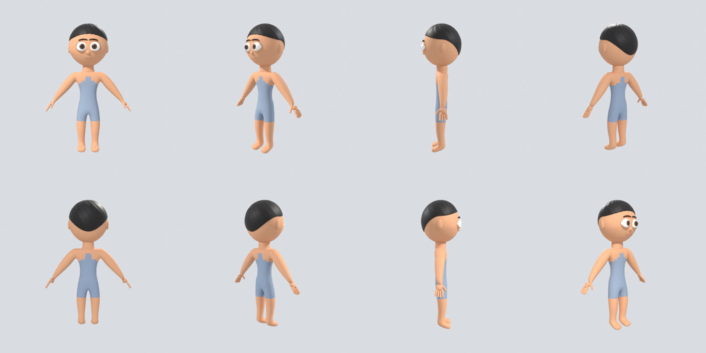
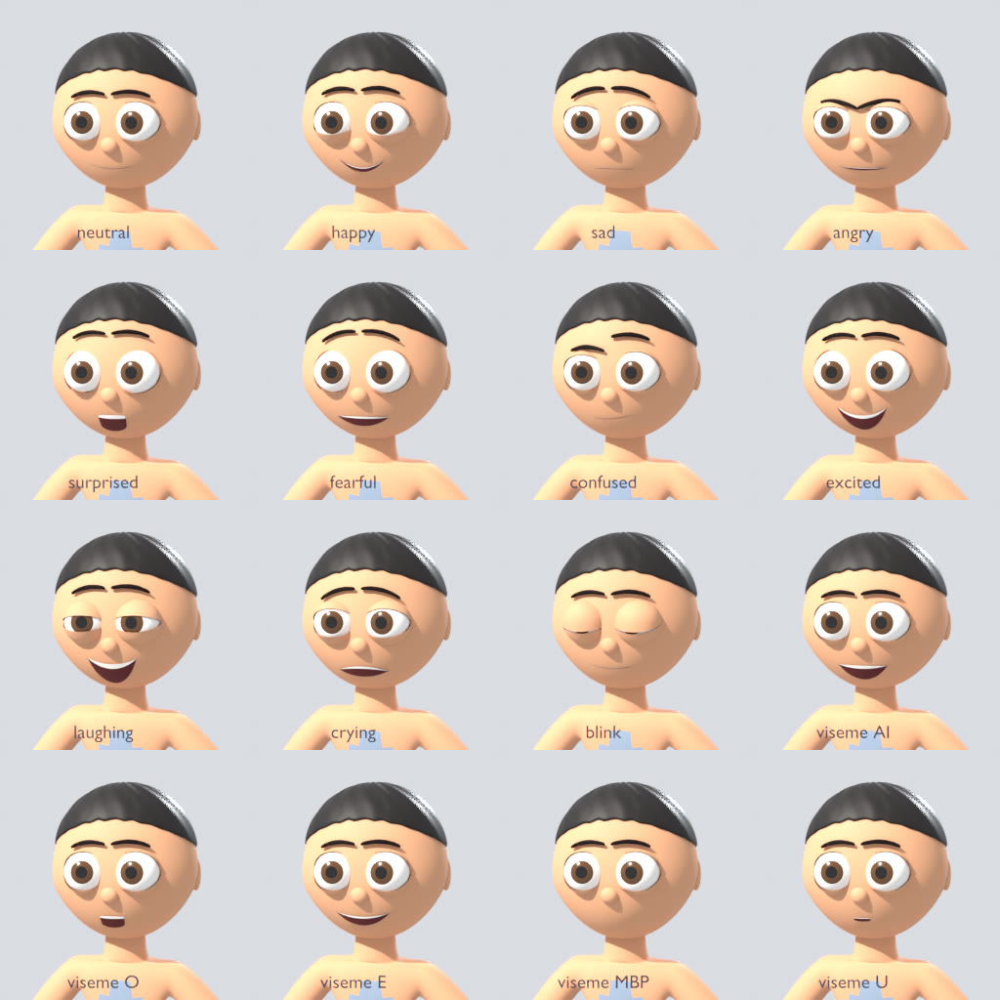

# Phase 2 demonstration: Character Factory

This page records the run made on 2026-11-04 on the `v2-12-character-previews` branch
(stacked on `v2-08` to `v2-11`), against the full compose stack: PostgreSQL 16, Redis 7,
SeaweedFS 4.50, Keycloak 26.4, the API, the Blender worker (bpy 5.2.3 LTS) and the AI worker.

> **The character is built on a procedural stand-in template, not production art.**
> Q2 (who authors the base template, risk R1) is still open. `TPL-HUMANOID-STANDIN@0.1`
> meets the rig standard and every interface an artist-made template will plug into, so the
> pipeline is real, but the look is a placeholder (architecture 8.4).

## Acceptance criteria (SRS section 30, Phase 2)

```
$ docker compose -f infra/compose.yaml up -d
$ python scripts/phase2_acceptance.py --out /tmp/phase2
PASS  specification validates against the style profile  (fit profile child_average, digest 6816efcad0ba)
PASS  an unsupported value is rejected with its path
PASS  the job API refuses an invalid specification  (invalid_job_params)
PASS  generate_character job accepted  (01a1a707-3c32-776c-b133-cf5b0c3500e5)
PASS  Blender generated, saved, reopened and validated the character
      77 s on the worker with Blender 5.2.3 LTS; timings {'geometry_s': 1.53, 'rig_s': 0.82,
      'save_reopen_s': 0.14, 'validate_s': 0.74, 'turntable_s': 52.78, 'expressions_s': 16.68, 'glb_s': 0.26}
PASS  the in-job validator passed every check  (22 checks)
PASS  a character draft was recorded  (CHAR-001)
PASS  downloaded character.blend matches its SHA-256  (6,015,108 bytes)
PASS  downloaded character.json matches its SHA-256  (2,377 bytes)
PASS  downloaded validation.json matches its SHA-256  (2,256 bytes)
PASS  downloaded thumbnail.png matches its SHA-256  (246,917 bytes)
PASS  downloaded turntable.mp4 matches its SHA-256  (46,580 bytes)
PASS  downloaded turntable_sheet.png matches its SHA-256  (1,996,550 bytes)
PASS  downloaded expressions.png matches its SHA-256  (1,010,314 bytes)
PASS  downloaded preview.glb matches its SHA-256  (869,392 bytes)
PASS  validation.json says the saved file is valid
PASS  turntable MP4 rendered  (24 frames)
PASS  expression sheet rendered  (neutral, happy, sad, angry, surprised, fearful, confused, excited, laughing, crying, blink, viseme AI, viseme O, viseme E, viseme MBP, viseme U)
PASS  browser GLB exported with facial morph targets  (71 DEF joints)
PASS  the .blend reopens in a fresh background Blender process
PASS  reopened file: fk_arm_moves_hand_only  ({"hand_mean_m": 0.2936, "chest_max_m": 0.0})
PASS  reopened file: ik_leg_lifts_foot  ({"lift_m": 0.0928, "measured_m": 0.0927})
PASS  reopened file: head_turn  ({"head_max_m": 0.105})
PASS  reopened file: face_controls_move_face  ({"dead": []})
PASS  reopened file: visemes_override_mouth  ({"mouth": 0.0})
PASS  reopened file: eyes_track_target  ({})
PASS  reopened file passes every validator check  (Blender 5.2.3 LTS)

Phase 2 acceptance: all criteria passed.
```

| SRS criterion | How it was shown |
| --- | --- |
| Generate a recognisable stylised character | `generate_character` built "Ali" (child, 1.28 m, short black hair, brown eyes) from a validated specification; renders below |
| Save a valid .blend | the job saves, reopens with scripts disabled and validates before reporting success; `validation.json` (22 checks) is stored with the file |
| Reopen it in background Blender | the acceptance script downloads the file and reopens it in a separate Blender process, which runs the full validator again |
| Render a turntable | 24-frame H.264 MP4 plus a contact sheet and a 3/4 thumbnail, Cycles on the CPU |
| Test basic body movement | FK arm raise (hand moves 29 cm, lower spine 0), IK foot lift (9.3 cm asked, 9.3 cm measured), head turn carrying head, eyes and hair, eye tracking |
| Test facial expressions | every one of the 25 `face_ctrl` properties moves the face; a viseme fully overrides the mouth of an expression; labelled expression sheet below |







Also in [`phase-2/`](phase-2/): `turntable.mp4`, `character.json` (specification, resolved
numbers and digest) and `validation.json`.

## What Phase 2 delivered

| Branch | Content |
| --- | --- |
| `v2-08-character-spec` | `CharacterSpecification`, style profile `family_cartoon@1.0`, rig profile `cartoon_humanoid@1.0`, `validate_spec` (every issue at once) and `resolve_spec` (style words to numbers), `POST /characters/spec/validate`, `/style-profiles`, `/rig-profiles` |
| `v2-09-ai-interpret` | LLM providers ported from `studio/llm` (PR #16), `interpret_character` AI job with a closed proposal schema built from the style profile, semantic repair turn, `ai_generations` log (append-only), `ai` worker queue |
| `v2-10-character-geometry` | stand-in template: skeleton landmarks, body, head, eyes, eyelids, brows, mouth, 43 facial shape keys from face states, four hair styles, materials |
| `v2-11-character-rig` | Rigify rig fitted and generated headless, eye tracking, `face_ctrl` drivers, skin weights and masks, validator |
| `v2-12-character-previews` | `generate_character` job, turntable, expression sheet, GLB, CHAR draft outcome, acceptance script |

Tests: 117 pass (`make test`), including a supervisor run of `generate_character` in a real
Blender process and the validator on a reopened file.

## Not done, or done differently

- **The template is a stand-in** (above). Weights are computed from bone distances, not
  transferred from hand-painted weights. No UVs or textures yet.
- **AI interpretation was not run against a live model**: this environment has no provider
  key. The job, schema, repair loop and logging are tested with fake provider clients; with
  no key the job now fails at once with "set ANTHROPIC_API_KEY". Run
  `phase2_acceptance.py --ai "<description>"` with a key in `infra/.env` to exercise it.
  (The key check was fixed after the stack image was built, so the image used for this run
  still reported it as a retryable error.)
- **Reference images** are accepted as `uploads/` keys and sent to the model, but there is no
  upload endpoint yet.
- **No character library yet**: the build is recorded as a generic `CHAR-NNN` draft. Character
  identity/version tables, review and publishing are Phase 3, as the roadmap says.
- **Previews use Cycles CPU** (Eevee needs a GPU/EGL). A 512 px turntable takes about 50 s.
- **GLB is uncompressed** (no Draco/meshopt yet).
- **Validator gaps**: no non-manifold check (eyelids and the mouth are open shells by design),
  no body pose-suite contact sheet.
- The worker image still uses the sandbox-only Python base and the bpy wheel, as in Phase 1.
