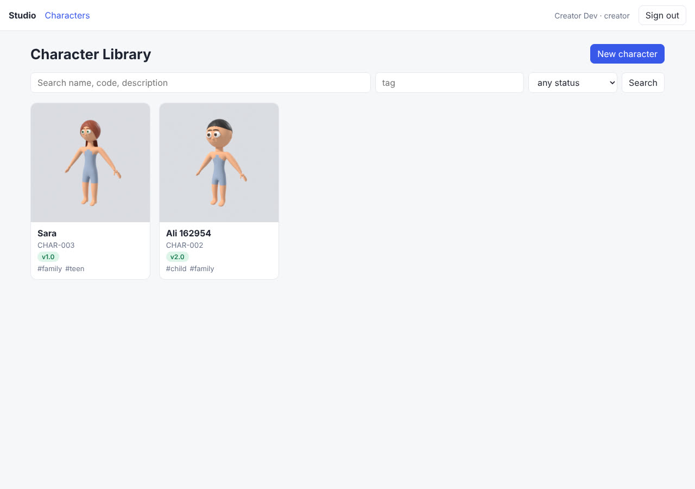
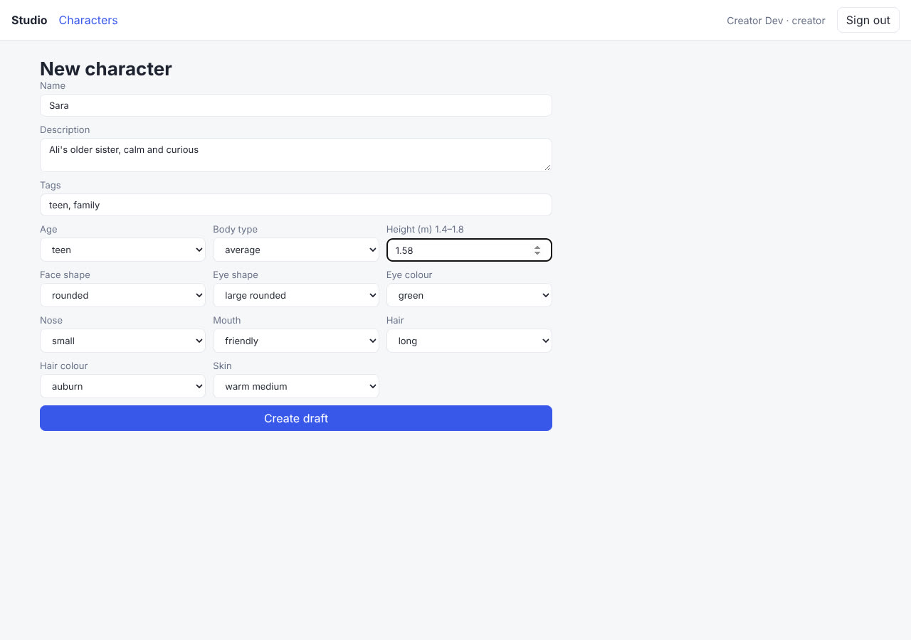
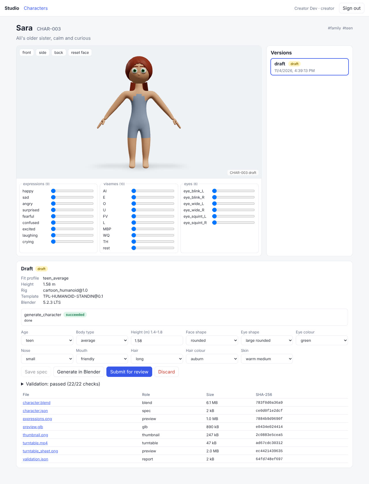
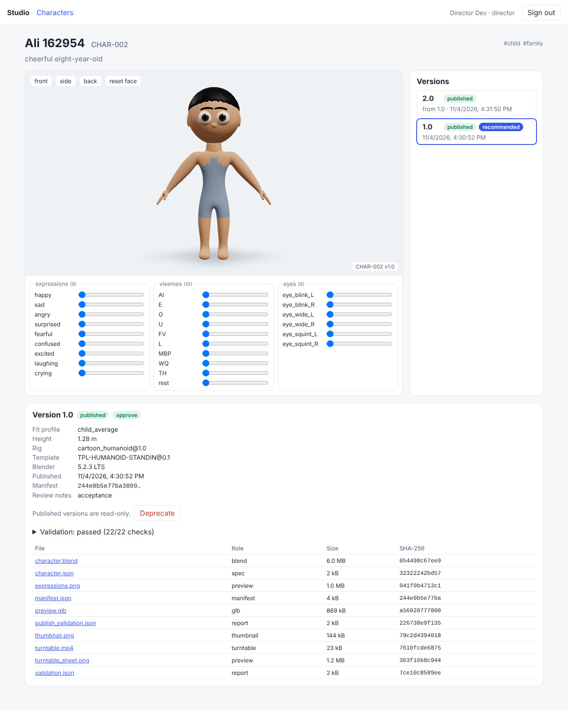
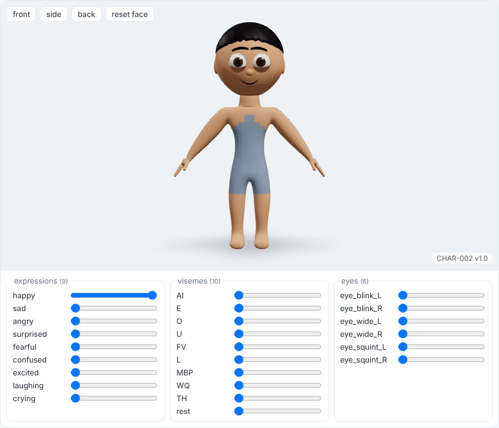
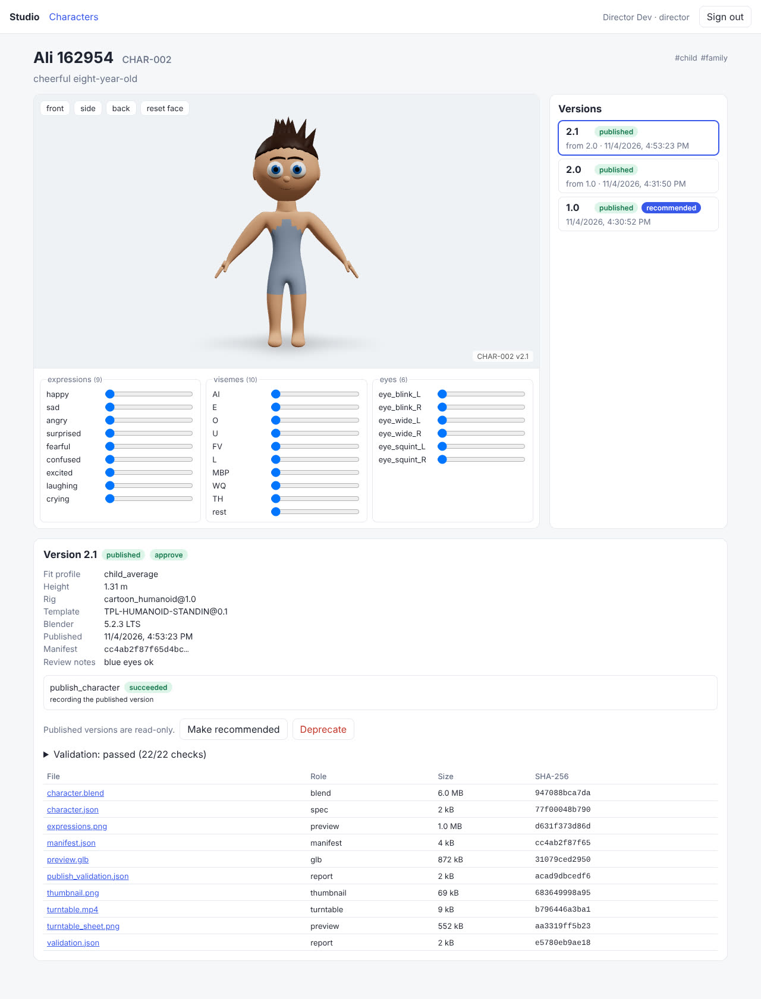

# Phase 3 demonstration: Character Library

This page records the run made on 2026-11-04 on the `v2-15-library-web` branch (stacked on
`v2-13-character-library` and `v2-14-character-publisher`), against the full compose stack:
PostgreSQL 16, Redis 7, SeaweedFS 4.50, Keycloak 26.4, the API, the Blender worker, the
publisher worker (bpy 5.2.3 LTS in both) and the web app from source.

> **The characters are built on the procedural stand-in template, not production art.**
> Q2 (who authors the base template) is still open; see architecture 8.4. Everything in this
> phase (versioning, immutability, publishing, loading) is independent of how the template
> looks.

## Acceptance criteria (SRS section 30, Phase 3)

`scripts/phase3_acceptance.py` drives the stack through the API only, as the `creator`,
`reviewer` and `director` users. All 60 checks passed in 121 s; the full log is
[phase-3/acceptance.log](phase-3/acceptance.log). Abridged:

```
$ python scripts/phase3_acceptance.py --out /tmp/phase3
PASS  character created with its first draft  (CHAR-002 01a1a765-45a1-7225-9696-d4ff8dcc3f35)
PASS  Blender built and validated the draft
PASS  the build is attached to the draft and current  (8 files, built from 6816efcad0ba)
PASS  draft submitted for review
PASS  reviewer approved it
PASS  publish job accepted on the publisher queue
PASS  publisher re-validated, copied and recorded the version
PASS  version 1.0 published  (library/characters/01a1a765-…/versions/1.0/manifest.json)
PASS  1.0: manifest.json matches the recorded SHA-256  (244e0b5e77ba3099)
PASS  1.0: character.blend SHA-256 matches manifest and registry  (6,015,108 bytes)
      … and the same for the other 9 files
PASS  API refuses to edit published 1.0  (not_a_draft)
PASS  API refuses to rebuild published 1.0  (not_a_draft)
PASS  API refuses to publish 1.0 again  (invalid_version_status)
PASS  API refuses to delete published 1.0  (not_a_draft)
PASS  storage refuses a library write with the worker identity  (AccessDenied)
PASS  storage refuses a library write with the api identity  (AccessDenied)
PASS  storage refuses to overwrite 1.0 even for the publisher (If-None-Match)  (PreconditionFailed)
PASS  database refuses: UPDATE character_versions  (ERROR: character version … is published, it cannot be changed)
PASS  database refuses: UPDATE asset_files  (ERROR: files of asset version … (published) cannot be update)
PASS  1.0 character.blend is byte-for-byte unchanged  (054498c67ee9dddd)
PASS  new draft created from published 1.0
PASS  the draft's spec was changed (hair, height)
PASS  1.0 is untouched by the new draft
PASS  Blender built and validated the draft
PASS  version 2.0 published  (library/characters/01a1a765-…/versions/2.0/manifest.json)
PASS  2.0 manifest records it is based on 1.0
PASS  both versions link into one fresh Blender scene
PASS  1.0 loads from its own library file and passes every check  (CHAR_Ali / rig, 22 checks, height 1.28)
PASS  2.0 loads from its own library file and passes every check  (CHAR_Ali.001 / rig.001, 22 checks, height 1.31)
PASS  the two loaded versions are different builds
PASS  gallery shows the character with its versions  (counts {'published': 2})
PASS  version history lists 2.0 then 1.0

Phase 3 acceptance: all criteria passed in 121 s.
```

| SRS criterion | How it was shown |
| --- | --- |
| Publish character version 1.0 | built, submitted, approved by the reviewer, published by the director; the publisher re-validated the exact `character.blend` in a fresh Blender process and wrote every file once under `library/characters/{uuid}/versions/1.0/` with [manifest.json](phase-3/manifest-1.0.json) |
| Prevent overwriting the published version | refused at every layer: API (edit, rebuild, republish, delete), storage (worker and API identities cannot write the library; the publisher's own second write is refused by `If-None-Match`), database (triggers refuse the version and its file rows); the downloaded file is byte-identical afterwards |
| Create a new draft from the published version | `POST /characters/{id}/drafts {based_on_version_id}` copies the 1.0 spec; the draft was changed (spiky dark-brown hair, 1.31 m) while 1.0 stayed as it was |
| Publish version 2.0 | `bump: major`; [manifest-2.0.json](phase-3/manifest-2.0.json) records `based_on: 1.0` |
| Load either version independently | both `character.blend` files, downloaded through presigned URLs and checked against the manifest, were linked into one fresh Blender scene with library overrides; each kept its own library file and passed all 22 validator checks (structure, FK arm, IK leg, head turn, face controls, visemes, eye tracking) through its override ([load_check.json](phase-3/load_check.json)) |

## The web app

The same lifecycle through the browser, as three users, recorded with headless Chromium:
the creator made "Sara" (teen, long auburn hair, green eyes) from the form, built her and
submitted her; the reviewer approved; the director published her as 1.0. The director also
published a third version of Ali (blue eyes, a minor bump to 2.1) from the version page.

| | |
| --- | --- |
|  |  |
| Gallery: thumbnail, code, latest published version, tags; search by name, code or description, filter by tag and status | New character: the specification controls come from the style profile, so the form offers only values the validator accepts |



Draft after "Generate in Blender": the job's progress, the GLB viewer with every
expression, viseme and eye morph target, the validation result (22/22) and the files with
their SHA-256. "Submit for review" is enabled only when the build is current and valid.



A published version: read-only, with its manifest hash and library files; the version
history on the right shows 2.0 based on 1.0, with 1.0 still the recommended version (it
only changes by an explicit "Make recommended").





Ali 2.1 just after the director pressed Publish: the publish job's result, the new library
files (with `manifest.json` and `publish_validation.json`), and the history 2.1 → 2.0 → 1.0.

The `happy` slider drives the brow, eye and mouth morph targets of the expression together,
straight from `preview.glb` in the browser.

## What changed in the code

- **v2-13** `characters` and `character_versions` (migration 0005) with guards: a version
  in review only changes its review and publish record; published and deprecated versions
  only gain `deprecated_at`; codes never change; the recommended version must be published.
  The library service and `/characters` API (architecture 12.1). Submit needs a build made
  from the current spec that passed validation and whose report names the exact blend.
- **v2-14** `publish_character` on the `publish` queue, run by `worker-publisher` with the
  publisher storage identity. Version numbers claimed by a write-once marker, so a failed
  publish never leaves a published row and a resumed one writes identical bytes. Major bump
  forced when the template family, rig profile or body-fit profile changes.
  `cartoon_engine.character.library` links versions with library overrides.
- **v2-15** the web app in `web/`.

Tests: 142 Python tests (including a real-Blender publish of 1.0 and 2.0 with both loaded
in one scene, and fast publisher tests for resume, number skipping, tampered draft files and
failed re-validation) and 3 web component tests, all passing.

## Not done in this phase

Stated so nothing above is read as more than it is:

- Undeprecate (admin), the draft garbage collector, `GET …/usage`, the nightly re-hash, and
  the AI `interpret` route under a draft (the `interpret_character` job exists on its own).
- The web app has no outfit, scene or admin screens yet, no SSE (job progress is polled),
  and is run from source with `npm run dev`; it is not in the compose stack or an image.
- The publisher's Blender log is not uploaded (its identity cannot write the work bucket);
  a failed publish carries the log tail in the job error.
- Approval does not enforce a different person from the author; any user with
  `asset.review` can approve.
- The AI path was not exercised live in this run (no provider key in this environment).
