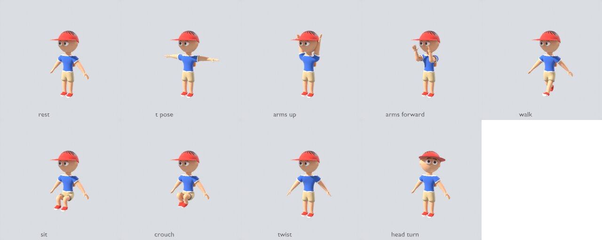
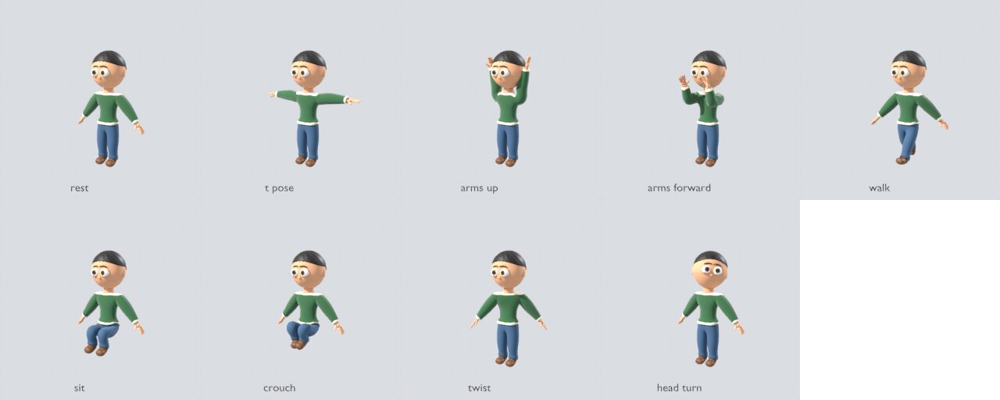
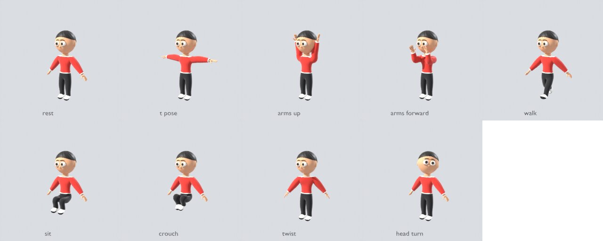
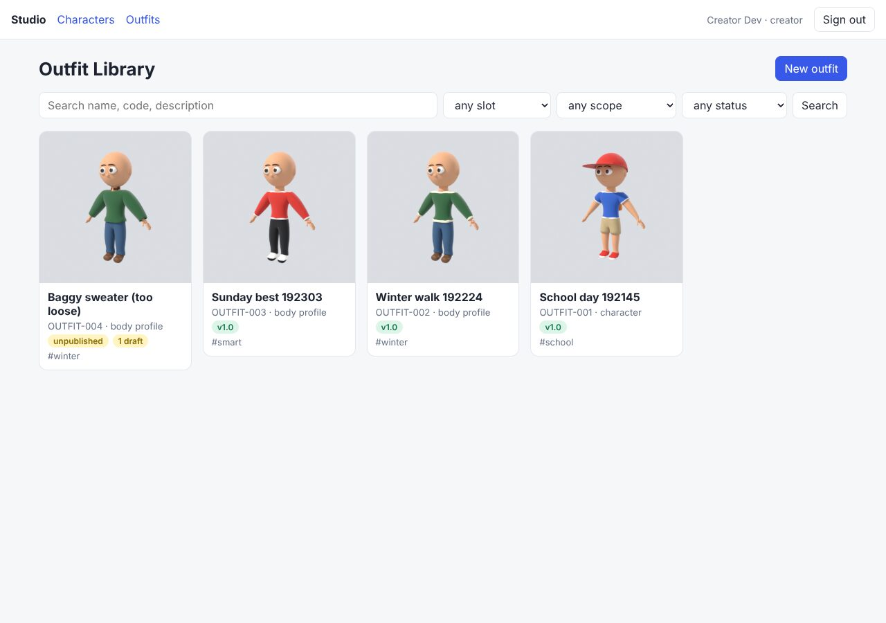
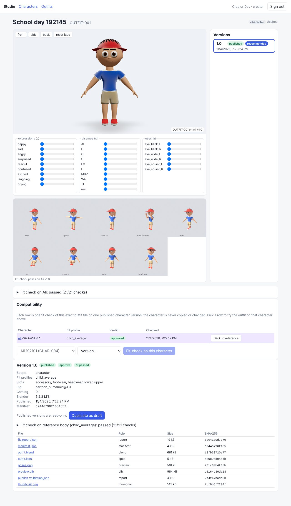
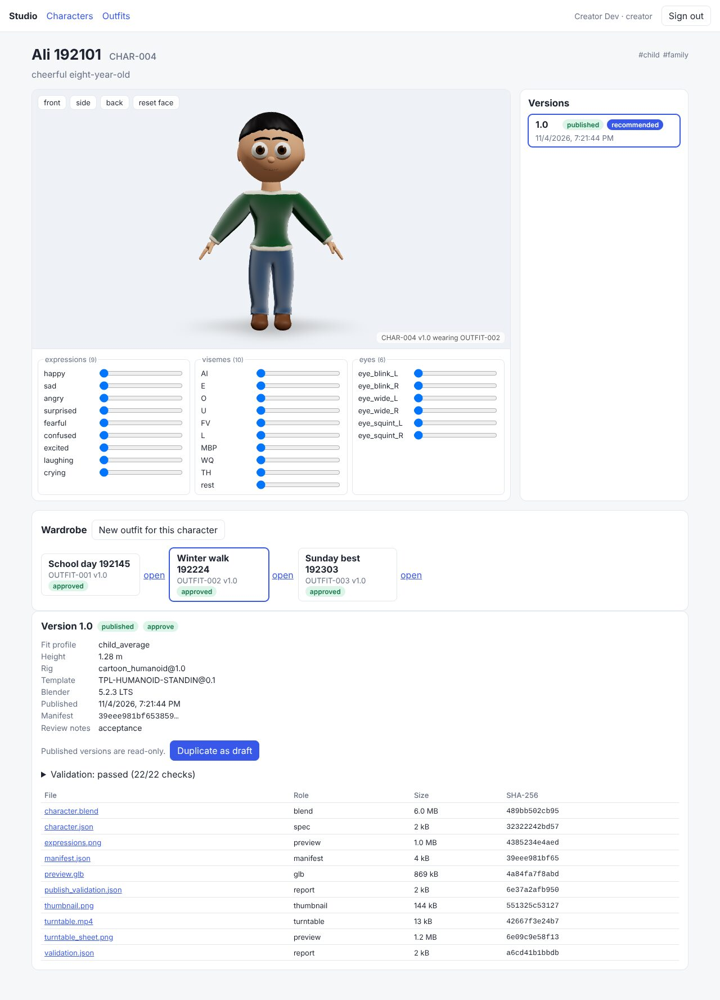
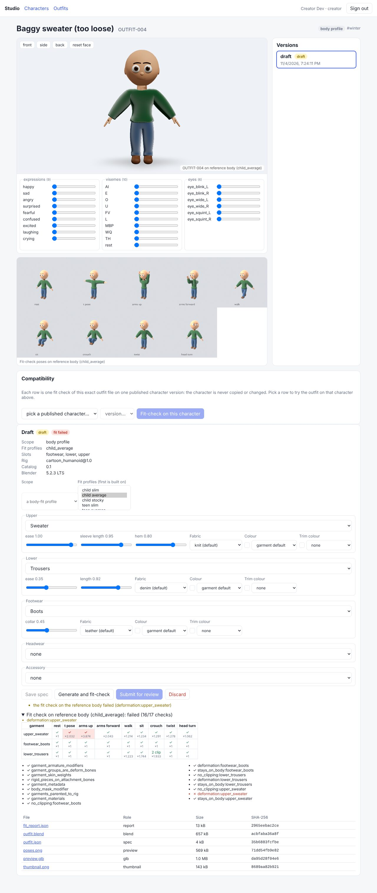

# Phase 4 demonstration: Outfit Factory

This page records the run made on 2026-11-04 on the `v2-19-outfit-web` branch (stacked on
`v2-16-outfit-spec`, `v2-17-outfit-geometry` and `v2-18-outfit-library`), against the full
compose stack: PostgreSQL 16, Redis 7, SeaweedFS 4.50, Keycloak 26.4, the API, the Blender
worker and the publisher worker (bpy 5.2.3 LTS in both), with the web app from source.

> **The garments are procedural stand-ins, not production art.** They are cut from the
> stand-in body and built by code (`GARM-*@0.1`), just as the characters are built on the
> stand-in template (Q2, architecture 8.4). The parts that would carry over to authored
> garments are the specification, the fit through skeleton space, the body mask, the fit
> check, versioning, compatibility and publishing.

## Acceptance criteria (SRS section 30, Phase 4)

`scripts/phase4_acceptance.py` drives the stack through the API only, as the `creator`,
`reviewer` and `director` users. All 59 checks passed in 166 s. The full log is
[phase-4/acceptance.log](phase-4/acceptance.log). Here is an abridged version:

```
PASS  Ali 1.0 published  (library/characters/…/versions/1.0/manifest.json)
PASS  school: outfit created (character)  (OUTFIT-001 …)
PASS  school: Blender built the garments and fit-checked them on the reference body
PASS  school: outfit.blend holds the outfit alone (no armature, no character)  (OUTFIT_School_day_192145, 5 meshes)
PASS  school: attached to Ali's published character.blend  (rig within 0.00 mm)
PASS  school: basic deformation holds in every pose (clipping, stretch, lift)  (13 garment checks over 9 poses)
PASS  school: reviewer approved the fit
PASS  school: publisher re-checked outfit.blend in a fresh process and published 1.0
      … the same for winter (OUTFIT-002) and smart (OUTFIT-003)
PASS  school: its own library prefix, every SHA-256 matches manifest and registry  (7 files)
PASS  school: the published files hold no character
PASS  school: the manifest names its wearer by reference  (scope character, fits [('CHAR-004', '1.0', 'approved')])
PASS  no character was created or copied by the outfits
PASS  Ali 1.0 is untouched (files, rows, character.blend bytes)
PASS  Ali's wardrobe lists the three approved outfits  (OUTFIT-001, OUTFIT-002, OUTFIT-003)
PASS  the linked character keeps its geometry in its own file
PASS  school: attached alone to the linked character, every pose passes, detached cleanly  (5 pieces, 21 checks, 868 body vertices masked)
PASS  winter: attached alone to the linked character, every pose passes, detached cleanly  (3 pieces, 17 checks, 1772 body vertices masked)
PASS  smart: attached alone to the linked character, every pose passes, detached cleanly  (3 pieces, 17 checks, 1608 body vertices masked)

Phase 4 acceptance: all criteria passed in 166 s.
```

| SRS criterion | How it was shown |
| --- | --- |
| Generate three outfits for one character | Three outfits were made for Ali. School day (t-shirt, shorts, sneakers, cap, backpack) has `character` scope and Ali as its owner. Winter walk (sweater, trousers, boots) and Sunday best (long sleeve, trousers, sneakers) are scoped to his body-fit profile, `child_average`. Each was generated in Blender from a validated `OutfitSpecification`. |
| Attach each independently | Each outfit was fitted to Ali's published version in its own `fit_outfit` job. The worker staged the exact library `character.blend` and the draft `outfit.blend` for each job, with SHA-256 checks. At the end, Ali's library file was linked into one fresh Blender scene, and each published outfit was put on, checked and taken off again in turn ([wardrobe_check.json](phase-4/wardrobe_check.json)). The character's modifiers and vertex groups were the same after each one. |
| Validate basic deformation | The fit check runs nine poses: rest, T-pose, arms up, arms forward, walk, sit, crouch, twist and head turn. In each pose it checks clipping in both directions (skin through cloth and cloth into skin), edge stretch against the stretch of the skin underneath, and how far the cloth lifts off the body. It also checks the structure: armature binding, deform-bone weights, rigid pieces on their bones and the body mask. Every check passed for all three outfits on the reference body and on Ali, and passed again in the publisher. |
| Publish all three without duplicating the character identity | Each outfit is its own asset (`OUTFIT-001…003`) with its own version 1.0 under `library/outfits/{uuid}/versions/1.0/`. None of their files is a character. Each `outfit.blend` holds one `OUTFIT_` collection with no armature. The manifests refer to Ali by version id ([school](phase-4/school-manifest.json), [winter](phase-4/winter-manifest.json), [smart](phase-4/smart-manifest.json)). Ali's published version, its rows and the bytes of its `character.blend` are unchanged, and the character count did not change. |

The pose sheets of the three fits on Ali:





## How it works

- **Specification** (`v2-16`): An outfit is one catalog garment per slot (upper, lower, footwear, headwear, gloves, accessory). Each garment has parameters within its declared ranges, plus a fabric and colours from the style's clothing conventions. The spec also sets the outfit's scope and body-fit profiles. `interpret_outfit` turns a text brief into this closed schema, and the result is validated like any hand-made spec.
- **Geometry** (`v2-17`): Garments are cut from the reference body of the primary fit profile and offset by the fabric's clearance, then pushed clear of the body and the layers below. They are weighted from the body, smoothed in the middle of the garment and pinned to the skin at the hems. The garments are saved alone in `outfit.blend`.
- **Fitting**: Fitting retargets the garments onto any character with the same rig profile, through skeleton space (bodies differ in topology). Rigid pieces such as the cap and backpack are parented to their bones. A Geometry Nodes body mask hides the skin under each garment. All of this works on a linked, library-overridden character.
- **Library** (`v2-18`): Outfit versions follow the same lifecycle and database guards as character versions.
- **Submit gate**: Submit needs a passing fit check on the reference body. A character-scope outfit also needs a verified fit on a published version of its owner.
- **Compatibility registry**: Each fit check is one row in `outfit_compatibility`, with the fit report and both blend SHA-256s as evidence. The status goes from candidate to verified or failed, then to approved or revoked. An approved row's evidence is frozen in the database, and the rows of a published outfit version are kept.
- **Publishing**: The publisher re-checks the exact `outfit.blend` in a fresh Blender process: the file must hold the outfit alone, carry the spec digest stamp and pass the fit check again.
- **Web** (`v2-19`): The web app has an outfit gallery and a new-outfit form. The outfit page shows a try-on viewer and pose sheet on either the reference body or any checked character, and the fit report as a garment-by-pose grid. It also has the compatibility table and the version actions. The character page has a wardrobe that puts any checked outfit on the character in the viewer.

| | |
| --- | --- |
|  |  |
| Outfit gallery | School day on Ali: the try-on viewer, the pose sheet, the compatibility table (approved) |
|  |  |
| Ali's wardrobe, wearing Winter walk | A sweater at ease 1.0 fails `deformation:upper_sweater` (sleeves stretch ×3.9 with arms up), so the draft cannot be submitted |

## Known limits (documented, not hidden)

- **No cloth simulation.** Garments are skinned to the rig. `cloth_simulation` exists in the spec, but validation answers it with a `not_supported` warning and the build ignores it.
- **Fit evidence lives in the work bucket.** The fit-job outputs (report, pose sheet, try-on GLB) are kept under `jobs/…` in the work bucket and linked from the registry row. They are not copied to the library when the outfit is published, though the manifest records the fits. Garbage collection of the work bucket must keep the objects that registry rows reference.
- **Extreme bodies.** The garments are built on the reference body of their primary fit profile. On a much larger character (a stocky child at the top of the height range), the trousers clip through the boots in a deep crouch. The check reports this correctly as a failed fit, so that outfit is not compatible with that character until a fitted variant is made.
- **Only `fit_outfit` stages inputs today.** Other job types that need library files will add their own stager in `studio_workers/inputs.py`.
- **A fit job that fails** (for example, a swapped file refused by the SHA check) leaves the registry row as `candidate` with no verdict. Requesting the check again replaces it.
