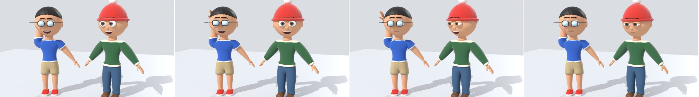
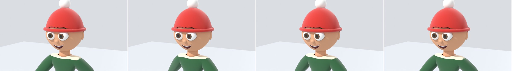
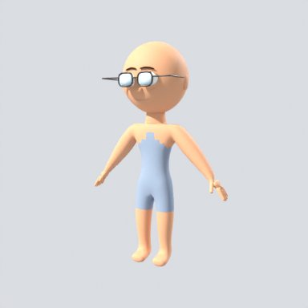
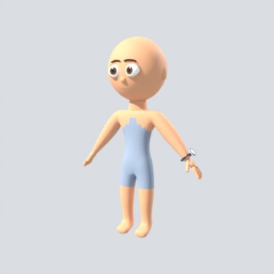
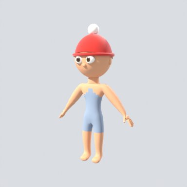
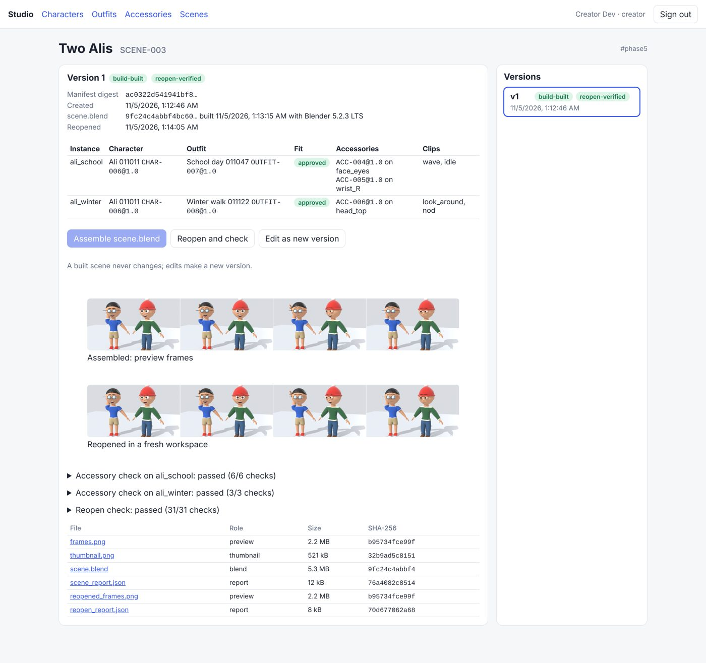
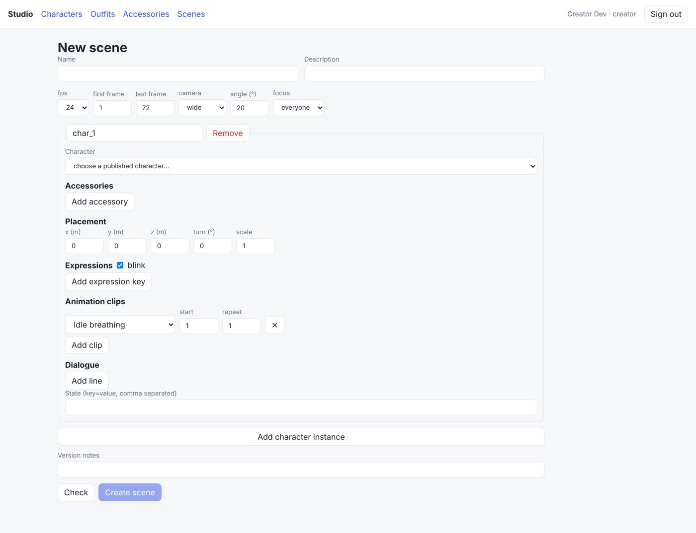
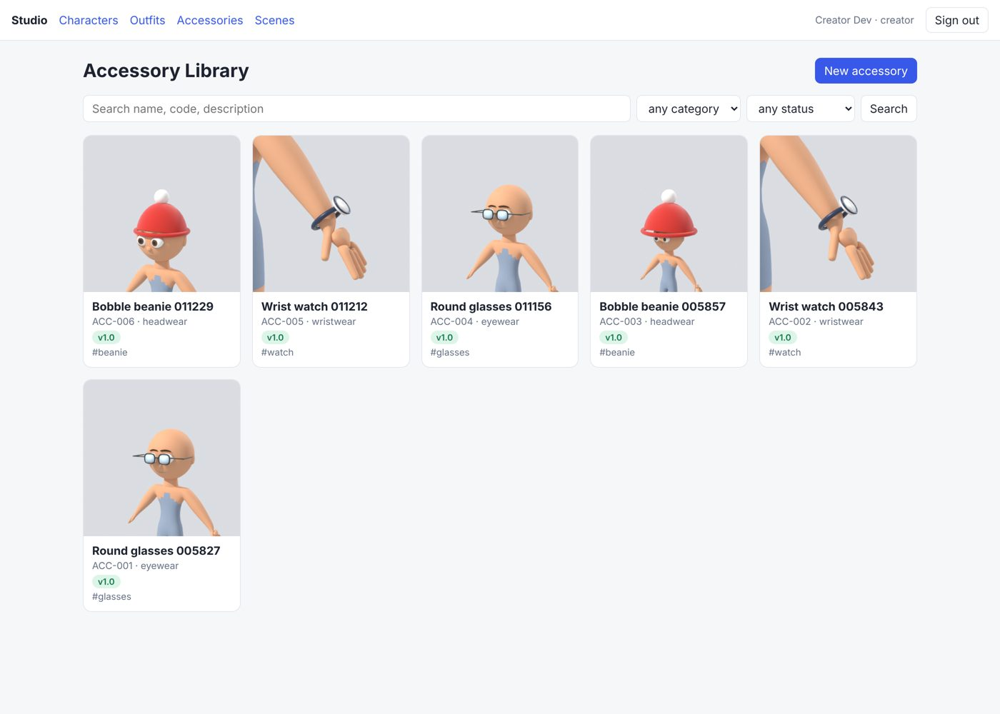
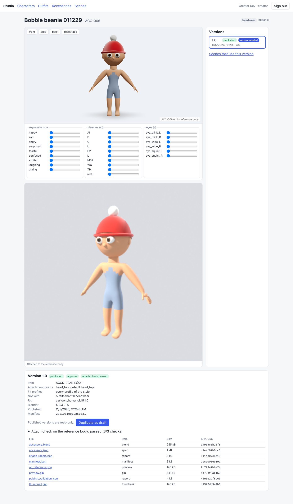

# Phase 5 demonstration: Character Assembly

This page records the run made on 2026-11-05 on the `v2-24-phase5-acceptance` branch (stacked on
`v2-20-accessory-library`, `v2-21-scene-assembly`, `v2-22-scenes-backend` and `v2-23-scenes-web`),
against the full compose stack: PostgreSQL 16, Redis 7, SeaweedFS 4.50, Keycloak 26.4, the API,
the Blender worker and the publisher worker (bpy 5.2.3 LTS in both), with the web app from source.

> **Accessories and animation clips are procedural stand-ins, not production art.** The
> accessories (`ACCD-*@0.1`: glasses, beanie, watch, tote, teddy) are built by code on the
> reference body, like the garments in Phase 4. The clips (`CLIP-*@0.1`: idle, wave, walk, nod,
> point, look around) are short motions keyed by code on the rig's FK controls. The versioned
> animation library, retargeting and lip sync are Phase 6. What carries over is the manifest,
> pinning, assembly, the reopen check and the guarantee that sources never change.

## Acceptance criteria (SRS section 30, Phase 5)

`scripts/phase5_acceptance.py` drives the stack through the API only, as the `creator`,
`reviewer` and `director` users. All 50 checks passed in 260 s. The full log is
[phase-5/acceptance.log](phase-5/acceptance.log). Here is an abridged version:

```
PASS  Ali 1.0 published
PASS  school / winter: fit-checked on Ali 1.0, fit approved, outfit published 1.0   (OUTFIT-007, OUTFIT-008)
PASS  glasses / watch / beanie: built, attach-checked in every pose, re-checked by the publisher, published 1.0   (ACC-004…006)
PASS  an accessory on a point it does not go on is refused before anything is built
PASS  two_alis: each instance pins exact versions and an approved fit
      (ali_school: CHAR-006@1.0 + OUTFIT-007@1.0 + ACC-004 on face_eyes, ACC-005 on wrist_R;
       ali_winter: CHAR-006@1.0 + OUTFIT-008@1.0 + ACC-006 on head_top)
PASS  two_alis: Blender assembled scene.blend (assemble_scene job)  (2 instance(s), scene.blend 9fc24c4abbf4bc60)
PASS  two_alis: scene.blend links only the pinned files, by relative path  (//../assets/character/CHAR-006/1.0/character.blend, …)
PASS  two_alis: the pinned sources were byte-identical after assembly  (7 files hashed before and after)
PASS  winter_walk: … the same for SCENE-004 (Ali in the winter outfit, beanie and watch)
PASS  the two scene files are separate
PASS  two_alis: reopened in a fresh workspace and matched its manifest (verify_scene job)  (31 checks)
PASS  winter_walk: reopened in a fresh workspace and matched its manifest (verify_scene job)  (18 checks)
PASS  ali / school / winter / glasses / watch / beanie: source asset unchanged (registry rows, stored bytes, status)
PASS  no character was created or copied by the scenes
PASS  Ali 1.0 is pinned three times across the two scenes, by reference

Phase 5 acceptance: all criteria passed in 260 s.
```

| SRS criterion | How it was shown |
| --- | --- |
| Assemble the same character with different outfits | "Two Alis" (SCENE-003) has two instances of the same character version, CHAR-006@1.0: one in the school outfit with glasses and a watch on the right wrist, one in the winter outfit with a beanie. Each instance is a separate library override of the one linked `character.blend`, with its own outfit fitted to it, its own accessories, placement, expressions, clips, dialogue and state. |
| Save multiple scene files | Two scenes were built, each by its own `assemble_scene` job: "Two Alis" and "Winter walk" (SCENE-004). Each has its own `scene.blend`, stored with the scene version. The worker staged every pinned library file read-only at `assets/<kind>/<code>/<version>/`, checked against the registry and the hash frozen in the version. Each `scene.blend` links those files by relative path and nothing else. |
| Reopen the scenes | A `verify_scene` job rebuilt a fresh workspace from the pins alone, put the stored `scene.blend` in a different directory and opened it with scripts disabled. Every library resolved, and every instance was checked against the manifest: the character override, the outfit bound to that instance's rig with its body mask, each accessory linked from its pin on the right bone, the hair under the hat masked, the placement, the expressions (measured on the face geometry), the clips and the dialogue mouth. The frames rendered after reopening are byte-identical to the ones rendered at assembly. The reports are [two-alis-reopen_report.json](phase-5/two-alis-reopen_report.json) and [winter-walk-reopen_report.json](phase-5/winter-walk-reopen_report.json). |
| Confirm the source character asset remains unchanged | Every pinned file was hashed before and after assembly, after rendering and again after reopening, inside the jobs. At the end, the script compared the registry rows, status and the SHA-256 of the bytes in the library bucket for Ali, both outfits and the three accessories with a snapshot taken before the scenes: identical ([before](phase-5/library_before.json), [after](phase-5/library_after.json)). No character was created or copied. |

Two Alis, assembled (frames 1, 24, 48 and 72):



Winter walk, medium shot:



The accessories on the reference body:

|  |  |  |
| --- | --- | --- |
| Glasses (face_eyes) | Watch (wrist_L or wrist_R) | Beanie (head_top) |

## How it works

- **Accessories** (`v2-20`): each accessory is its own asset (ACC-NNN) with versions, attachment points and compatibility metadata (rig and style profile, declared body-fit profiles, outfit slots it cannot be worn with), as SRS section 8 asks. The mesh stays in `accessory.blend`; a scene gets a local object that uses the linked mesh, parented to the attachment bone. Placement maps the reference attachment frame onto the wearer; hats are sized to the skull and hide the hair above their rim with a Geometry Nodes mask on that instance; rings (the watch) grow to clear the sleeve; solids (glasses, bag, toy) move off the body. The attach check runs a pose suite: on the attachment bone, rigid, clear of the body. Accessories follow the same draft, review and publish lifecycle and guards as characters and outfits.
- **Scene manifest** (`v2-21`): `SceneManifest` pins each instance's character, outfit and accessory versions by display code and version label, and holds the scene state: transform, expression keys, blinks, clips, dialogue lines and free-form state. `ResolvedScene` is what the Blender jobs get: version ids, file SHA-256s and the staging paths.
- **Assembly** (`v2-21`): each instance lives in a local `INST_<key>` collection. The character is linked and overridden (the same file any number of times), the outfit is appended and fitted to that instance and stamped with its source (`OUTFIT-007@1.0#sha256`), the accessories are linked and bound, clips become NLA strips and the face track drives the face controls.
- **Scenes backend** (`v2-22`): migration 0008 adds `scenes`, append-only `scene_versions` and the pins as rows (`scene_instances`, `scene_instance_accessories`) with real foreign keys, so "which scenes use CHAR-006@1.0" is a query and a pinned version can never be deleted. Database guards freeze the manifest, the pins and a built `scene.blend`. Creating a version runs every registry check at once: pins published (a deprecated pin is kept only where the version it is based on had it), the outfit fit approved on that exact character version (a verified fit needs a director's override, recorded on the version and audited), accessory compatibility, one accessory per point, expressions on the character's rig. The new `scene.edit` permission goes to creators, directors and admins.
- **Web** (`v2-23`): an accessory library (gallery, form, detail with 3D preview, attach report and version actions) and scenes (list, editor, scene page with pins, assemble and reopen actions, frames and reports).

| | |
| --- | --- |
|  |  |
| Two Alis: pins, approved fits, frames before and after reopening, the checks | The scene editor: one instance, with the character, outfit and accessory pickers below it |
|  |  |
| Accessory Library | The beanie: preview, versions, attach check |

## Known limits (documented, not hidden)

- **Stand-in clips and accessories.** See the note at the top. Clip assignment is by reference (`CLIP-WAVE@0.1`), so swapping in the Phase 6 animation library does not change the manifest's shape.
- **Shape-key values after a reopen.** In a reopened file, the overridden face Key reports its shape-key `value`s as 0 even though the evaluated face moves. The reopen check therefore measures each expression's weight on the evaluated head geometry (brow keys, since the mouth keys are damped by visemes and the eye keys by blinks).
- **Hats hide the hair above their rim.** That suits short or spiky hair. Long hair that should fall from under a hat would need hair authored for it.
- **Brows can show through a hat's rim** when the brows sit above the rim line (visible in the winter walk frames).
- **The `medium` camera preset frames tighter than intended** (head and shoulders rather than from the chest up).
- **Scene build files live in the work bucket**, under the job's prefix, linked from the scene version. Garbage collection of the work bucket must keep the objects scene versions reference.
- **A built scene version never changes.** To change anything, make a new version from it; a failed or ended build can be queued again.
