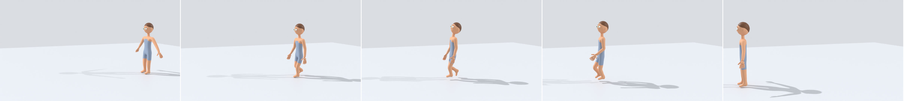
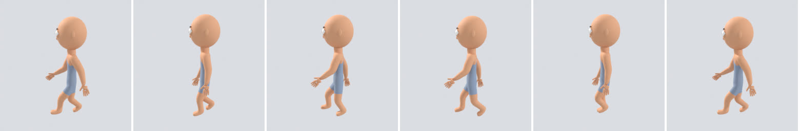
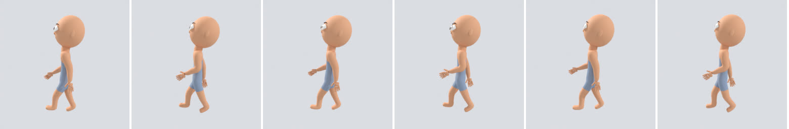
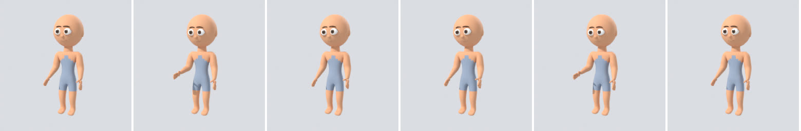
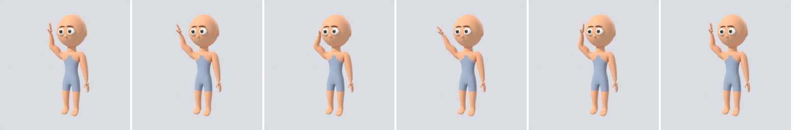
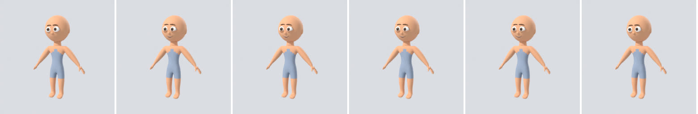

# Phase 6 demonstration: Animation System

This page records the run made on 2026-11-05 on the `v2-30-phase6-acceptance` branch (stacked on
`v2-25-animation-spec` … `v2-29-animation-web`), against the full compose stack: PostgreSQL 16,
Redis 7, SeaweedFS 4.50, Keycloak 26.4, the API, the Blender and publisher workers (bpy 5.2.3 LTS)
and the new media worker (ffmpeg and Rhubarb Lip Sync 1.14.0, SHA-256 pinned).

> **What is procedural and what is not.** The walk, talk, wave, nod, point, look-around, idle
> and expression animations are *generators*: deterministic code that keys the rig's
> controls from a few parameters (cadence, stride, intensity …). They are checked
> motions, not hand-animated performances. The motion-capture walk is a real take (CMU
> subject 2, trial 1), retargeted onto the rig. The dialogue recording is synthetic
> speech (espeak-ng); the mouth cues are Rhubarb's.

## Acceptance criteria (SRS section 30, Phase 6)

`scripts/phase6_acceptance.py` drives the stack through the API only, as the `creator`,
`reviewer` and `director` users. All checks passed in 365 s. The full log is
[phase-6/acceptance.log](phase-6/acceptance.log). Here is an abridged version:

```
PASS  Ali 1.0 published (child_average)                                    CHAR-012
PASS  Dev 1.0 published (adult_average)                                    CHAR-013
PASS  walk: built and play-checked by Blender on child_average, adult_average
      (slide 0.44 / 0.03 cm, stretch 0.99; 24 frames, 18 controls, stride 0.57 m)   ANIM-011
PASS  talk / happy (expression take) / wave (child bodies only): built, play-checked, published
PASS  CMU walk take uploaded; retargeted and play-checked
      (slide 1.25 / 1.85 cm, stride 1.43 m; 68 frames, 20 controls)          ANIM-015
PASS  the media worker normalised the recording and found its mouth cues
      (4.34 s, 16 cues: AI, E, MBP, O, U; analyser rhubarb-1.14.0)          AUDIO-003
PASS  a wave declared for child bodies is refused on the adult before anything is built
PASS  each library animation is pinned by exact version and file hash
PASS  every animation fitted to the character's legs  (Ali x1.036, Dev x1.638)
PASS  both scenes reopened in a fresh workspace and matched their manifests (19 and 18 checks)
PASS  Ali walks: the root travelled the stride the feet imply and the planted feet held
      (1.184 m expected and measured, worst slide 0.46 cm)
PASS  Dev walks: the same (1.871 m, worst slide 0.03 cm)
PASS  the same walk version plays on two characters, scaled to each one's legs
PASS  the motion-capture walk plays on Dev with its feet planted  (2.27 cm, limit 3.0)
PASS  Ali talks: the recording plays from the scene and the mouth follows it
      (//../audio/AUDIO-003/dialogue.wav; frame 68 shows vis_U at 1.0)
PASS  Ali's expressions play
PASS  the walk version is pinned in both scenes, by reference
PASS  every animation version unchanged (registry rows, stored bytes, status)

Phase 6 acceptance: all criteria passed in 365 s.
```

| SRS criterion | How it was shown |
| --- | --- |
| Character can walk | The walk generator and the CMU take are each played on two reference bodies (child and adult) by the build job. Each check measures foot slide, leg stretch, sinking into the floor and the loop seam; the publisher checks again in a fresh process. In the scenes, the walk is assigned as an NLA strip, the root is moved by the stride the feet imply (scaled to the wearer's legs), and the reopen check measures the planted feet in world space. |
| Character can talk | A recording is uploaded and turned into AUDIO-003 by the `lipsync` job on the media queue: ffmpeg normalises it to 16 kHz mono WAV, then Rhubarb finds the mouth shapes. A dialogue line names the clip. The scene freezes the WAV's SHA-256 and the cues, the face track keys each viseme for its cue, and a sound strip plays the staged recording by relative path. The reopen check confirms the strip opens the frozen file and that the mouth shows the recording's shape at that moment. The talking gestures are a library animation layered on top. |
| Character can perform basic expressions | Expression keys on the scene (neutral, happy, excited) are measured on the face geometry after reopening. A published "happy" expression take (GEN-EXPR) plays as a library animation. |
| An animation can be reused in another scene on a compatible rig | ANIM-011 (the walk) is pinned in two scenes, on Ali (a child, legs 0.42 m) and on Dev (an adult, legs 0.67 m). Both use the same rig profile, and each gets the walk fitted to its own legs. The scene usage endpoint lists both. An animation declared for child bodies only is refused on Dev by the scene validator, from the compatibility record its build measured (rig profile, keyed controls and face properties, declared body-fit profiles). |

Ali walks in, then talks with gestures and lip sync (frames 1, 28, 70, 100, 130, 180):


Dev uses the same walk, then the motion-capture walk (frames 1, 30, 70, 100, 130):



The library animations on the reference body, as the build job renders them:

| walk | motion-capture walk | talk |
| --- | --- | --- |
|  |  |  |
| **wave (child only)** | **happy** | |
|  |  | |

Reports: [Ali's reopen check](phase-6/ali-walks-and-talks-reopen_report.json),
[Dev's reopen check](phase-6/dev-walks-reopen_report.json), [the dialogue clip and its cues](phase-6/audio_clip.json),
the animation library [before](phase-6/library_before.json) and [after](phase-6/library_after.json) the scenes.

## What was built

* **Contracts:** the animation specification (a generator with parameters, or a BVH take
  with a bone map and licence), the generator catalog, CMU and Mixamo bone maps, the
  compatibility record, and dialogue cues with the Rhubarb-to-viseme mapping.
* **Engine:** eight generators, BVH import and retargeting onto the rig's FK controls,
  grounding and stance-foot locking for takes, fitting to the wearer (location curves
  scaled by leg length), NLA strips with blends, root travel, face tracks from audio cues,
  sound strips, and the build, publish and reopen checks.
* **Backend:** animations and animation versions with the shared lifecycle and guards
  (migration 0009), write-once uploads, scene pins with compatibility refusal, and dialogue
  clips (migration 0010).
* **Workers:** BVH staging for the build, audio staging for scenes, the publisher's
  animation kind, and the media worker (`worker-media`).
* **Web:** the animation library (gallery, new animation, version panel with the play
  check), dialogue audio (upload, status, cue strip), and library animations and
  recordings in the scene editor.
* **Tests:** 235 Python tests pass, plus one that runs only where Rhubarb is installed (including real-Blender end-to-end tests of reuse across
  rigs and of lip sync in a reopened scene) and 17 web tests.

## Limits and what is not done

* The generators are procedural stand-ins for an animator's work: believable and
  measured, not expressive. More generators or hand-keyed actions can be added to the same
  library.
* Motion-capture feet are held by correcting the torso against the stance foot, not by
  an IK foot lock. On the 1.74 m adult the CMU walk still slides 2.3 cm at worst, under
  the 3 cm limit for takes (generated cycles are held to 1.5 cm).
* There is one rig profile (`cartoon_humanoid@1.0`). A pin made for another profile is
  refused (unit-tested with a stand-in record), but no second rig exists yet to retarget
  between.
* Lip sync follows Rhubarb's shapes. Rhubarb never produces TH or W/Q, so those visemes are
  only reachable by manual keys. The built-in phonetic analyser remains as a fallback, used
  only when `STUDIO_RHUBARB_BINARY` is empty. Text to speech is not built.
* The reopen check samples the mouth at one cue per line. It does not score the whole sync.
* The web pages were type-checked, built and unit-tested, but not driven in a browser in
  this run.
