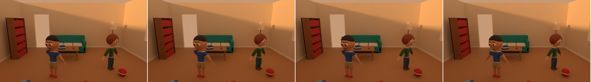
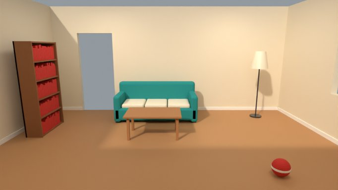
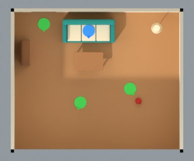
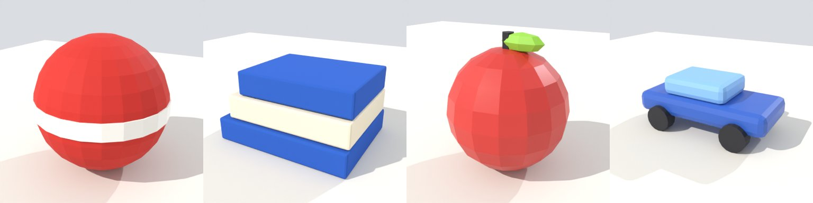

# Phase 7 demonstration: Environments and Scenes

This page records the run made on 2026-11-05 on the `v2-36-phase7-acceptance` branch (stacked on
`v2-31-environment-spec` … `v2-35-environment-web`), against the full compose stack: PostgreSQL 16,
Redis 7, SeaweedFS 4.50, Keycloak 26.4, the API (migration 0011 applied), and the Blender,
publisher and media workers (bpy 5.2.3 LTS).

> **What is procedural and what is not.** Props and environments are built by deterministic
> code from a fixed catalog: 14 prop items (table, chair, desk, sofa, bed, bookshelf, books,
> lamp, ball, toy car, apple, tree, bench, car) and 5 environment templates (living room,
> bedroom, classroom, park, street), each with parameters, finishes and colours. They are
> simple modelled stand-ins, not hand-made set pieces. Lighting comes from 6 presets (day,
> overcast, evening, night, warm indoor, daylight indoor). No AI is involved in Phase 7.

## Acceptance criteria (SRS section 30, Phase 7)

`scripts/phase7_acceptance.py` drives the stack through the API only, as the `creator`,
`reviewer` and `director` users. All checks passed in 546 s. The full log is
[phase-7/acceptance.log](phase-7/acceptance.log). Here is an abridged version:

```
PASS  ali: 1.0 published (child_average)                                   CHAR-016
PASS  maya: 1.0 published (child_slim)                                     CHAR-017
PASS  ali / maya: outfit built, fit-checked on the character, fit approved, published 1.0
PASS  ball / books / apple / car: Blender built it and its checks passed (5 checks each),
      publisher re-checked the .blend and published 1.0               PROP-005 … PROP-008
PASS  the prop gallery finds props by category
PASS  an environment whose dressing overlaps is refused before anything is built
      (sofa_2 overlaps sofa_1)
PASS  the living room's layout validates  (4 solid items, marks rug, window, sofa_seat, door;
      cameras wide, front)
PASS  living_room: Blender built it and its 35 checks passed; published 1.0      ENV-001
PASS  Blender measured the layout again: inside, grounded, clear, marks and door reachable
PASS  a prop in the sofa, an apple on the floor and an unknown mark are all refused
      before anything is built  (props[0].at: overlap; props[3].on: needs_surface;
      instances[1].mark: unknown_mark; …)
PASS  scene created; characters, outfits, props and the environment pinned     SCENE-011
PASS  each character starts at its mark, and props on the table stand on its top
      (ali at [-0.6, -0.8] facing -20°; books and apple at 0.4752 m; lighting evening,
      the room's own is indoor_day)
PASS  the environment and every prop are pinned by exact version and file hash
PASS  Blender assembled scene.blend in the set  (camera CAM_wide, 24 mm)
PASS  scene.blend links the environment and props from their pinned files, by relative path
PASS  the pinned sources were byte-identical after assembly
PASS  preview frames and a preview video were rendered  (24 video frames, every 2nd frame)
PASS  reopened in a fresh workspace and matched its manifest  (43 checks)
PASS  the set came back: environment from its pin, lighting, every prop grounded,
      inside and clear, paths clear  (17 set checks)
PASS  every character, outfit, prop and environment version unchanged

Phase 7 acceptance: all criteria passed in 546 s.
```

| SRS criterion | How it was shown |
| --- | --- |
| Assemble a scene with two characters, outfits, props and an environment | SCENE-011 pins Ali (CHAR-016) in a school outfit and Maya (CHAR-017) in a winter outfit, each with an approved fit, in the living room ENV-001. Four published props are placed: a ball and a toy car on the floor, books and an apple on the room's table. Ali starts at the `rug` mark, Maya at the `window` mark. Every placement was checked against the environment version's layout before saving, and again in Blender after assembly and after reopening. |
| Render a preview | The assemble job rendered four preview frames and a 24-frame preview video (every second frame of 48) from the room's `wide` camera mark, under an evening lighting override. A fresh workspace then reopened the scene, rendered it again and ran 43 checks. |
| Environment library (SRS 12) | Environments are versioned assets with geometry, materials, a lighting rig, camera marks, named marks (spawn, seat, interaction), set dressing, dimensions, a wide render, a top plan and a GLB preview. They go through draft, review and publish, and the publisher re-checks the `.blend` file. |
| Prop library (SRS 12) | Props have reusable codes (`PROP-NNN`) and immutable versions. Each version records its size, whether it is solid, and whether it stands on the floor or on a top. |
| Camera controls, lighting, scene preview (SRS 16.4) | A scene uses either a framing preset or one of the environment's camera marks. It can override the environment's lighting with any preset. The web scene editor shows the plan with marks, cameras, characters and props. |

### The scene

Assembled (frames 1, 16, 32, 48), from the room's wide camera mark under evening light:



Reopened in a fresh workspace:


The preview video is [phase-7/scene-preview.mp4](phase-7/scene-preview.mp4).

### The environment and the props

| The living room from its wide camera (its own daylight preset) | Plan: dressing, marks (green), a seat mark (blue) |
| --- | --- |
|  |  |



## What was built

* **Contracts:**
  * the prop catalog, the environment templates and the lighting presets;
  * the environment and prop specifications;
  * layout resolution and validation: footprint overlap, inside the set, door and marks reachable, seats and tops;
  * the scene's set fields: environment, props, lighting, marks and camera mark;
  * placement checks that run before anything is built.
* **Engine:**
  * procedural props;
  * room shells (with a camera-side cutaway wall) and outdoor ground;
  * openings, dressing, lighting rigs and camera marks;
  * the layout measured again in Blender;
  * wide, plan and thumbnail renders and a GLB;
  * the `generate_*` and `publish_*` jobs;
  * scene assembly that links the environment and props from their pinned files;
  * set checks on reopen, including each character's root path;
  * the preview video.
* **Backend:**
  * props and environments with the shared lifecycle and guards (migration 0011);
  * the `/props`, `/environments`, `/prop-items`, `/environment-templates` and `/lighting-presets` APIs;
  * publisher manifests;
  * scene pinning and placement checks against the pinned layout.
* **Web:**
  * the prop and environment libraries (gallery, new draft, version panel);
  * the environment form, which checks every change with the server's validator and draws the plan;
  * a Set section in the scene editor (environment, lighting, camera mark, props) with the plan;
  * a start-at-mark option for each character;
  * the preview video on the scene page.
* **Tests:** 282 Python tests pass and 1 is skipped (it runs only where Rhubarb is installed). These include real-Blender tests of sets, props, scene assembly in a set and reopen checks. There are also 24 web tests.

## Limits and what is not done

* **Catalog only.** Props and environments come from a fixed procedural catalog. There is no AI prop builder yet, and no importing of hand-made set pieces.
* **No sitting.** There is no sit animation. A seat mark places the character standing just in front of the seat, facing away from it, and the validator warns about it.
* **No ceilings.** Rooms have no ceiling, and their camera-side wall is hidden from the camera.
* **No navigation mesh.** Walkability is "free floor inside the set". The validator checks it on the plan footprints, and the reopen check measures each character's root path against the furniture. There is no navigation mesh.
* **Usage is not tracked for props and environments.** Environment and prop pins are recorded in each scene version's resolved manifest, but there are no usage rows for them yet. The "scenes that use this version" lookup covers characters, outfits, accessories and animations only.
* **Framing.** A camera mark is kept inside the room by moving it in and widening the lens (24 mm here). In this run, the ball and the toy car near the camera are partly out of frame. Framing is not checked.
* **Web not tested in a browser.** The web pages were type-checked, built and unit-tested, but not driven in a browser in this run.
