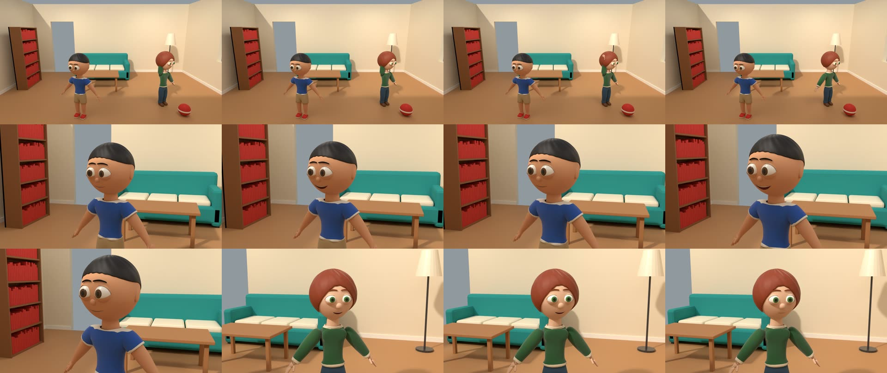
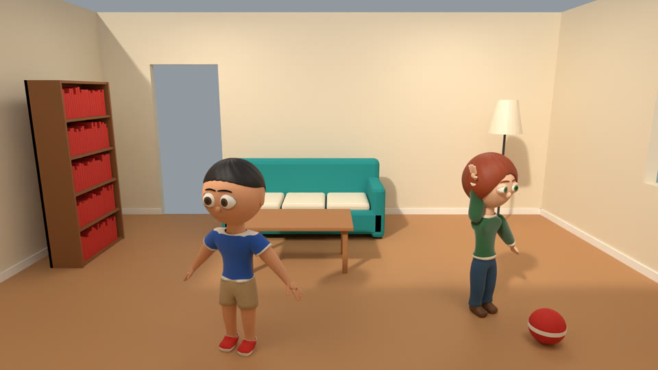
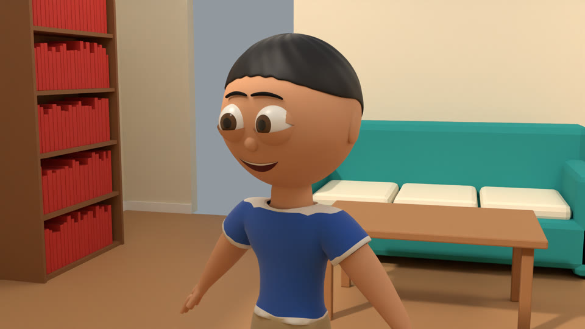
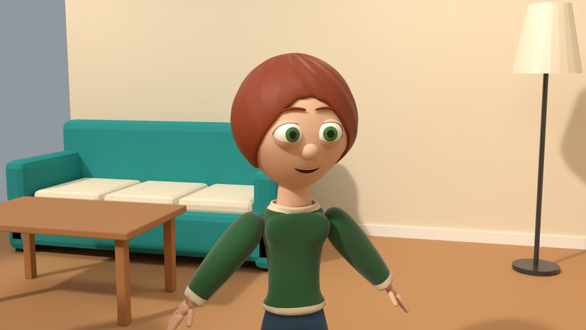
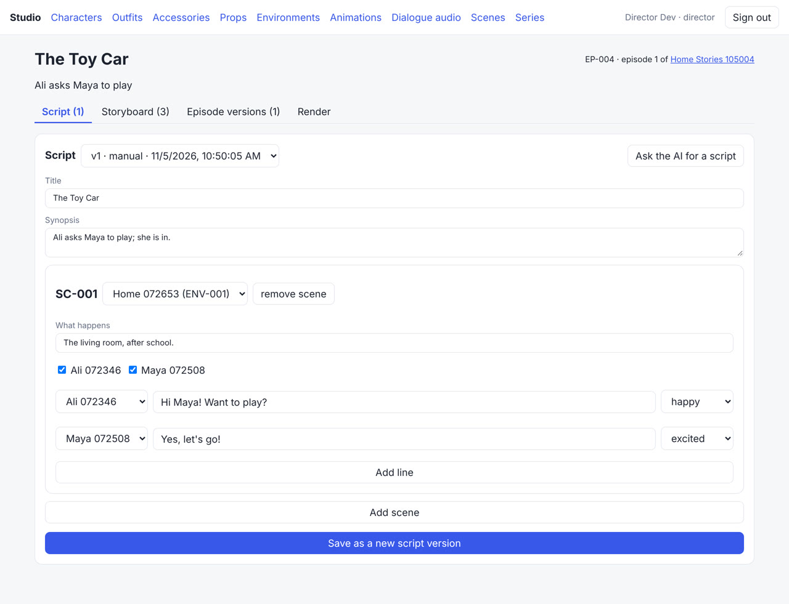
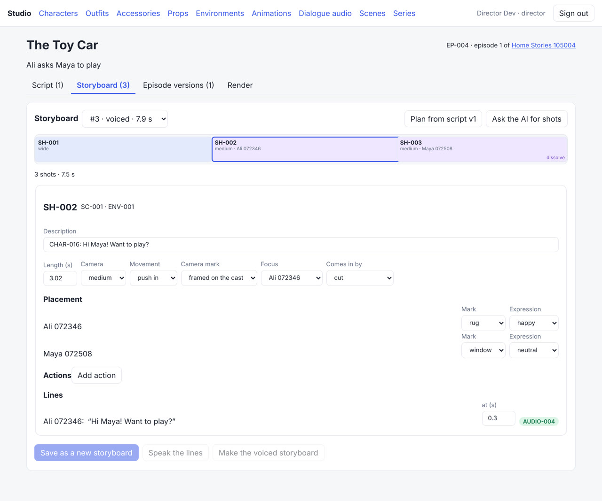
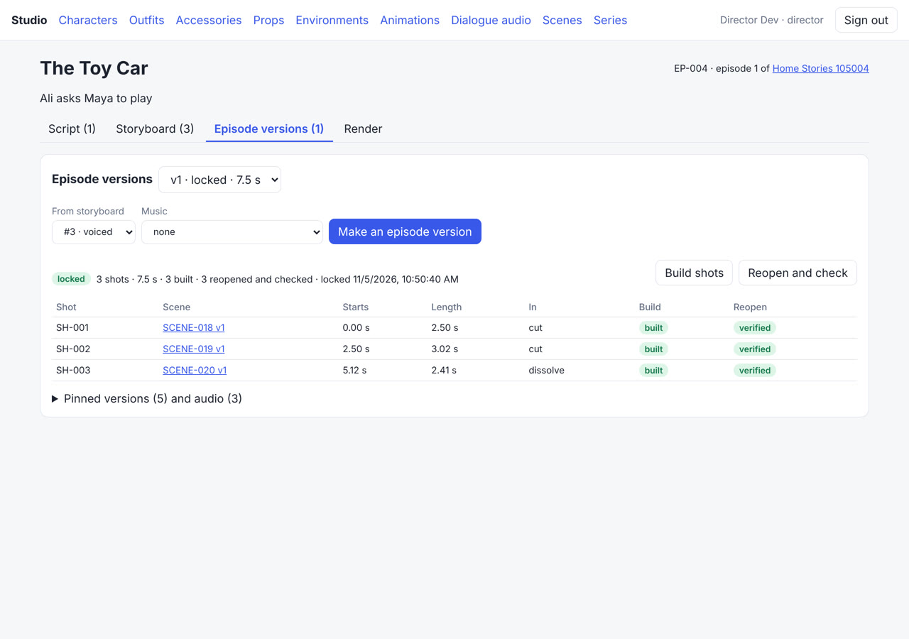
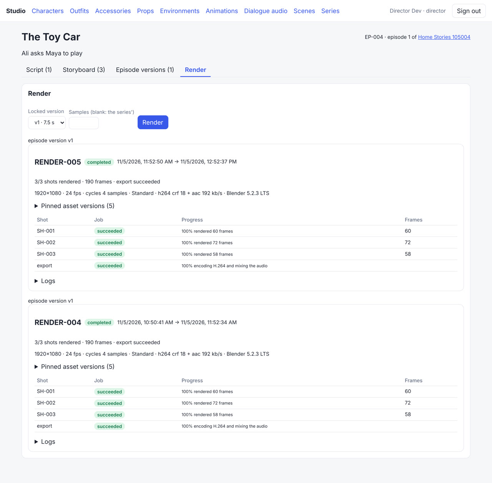

# Phase 8 demonstration: Episode Production

This page records the run made on 2026-11-05 on the `v2-42-phase8-acceptance` branch (stacked on
`v2-37-episode-spec` … `v2-41-episode-web`), against the full compose stack: PostgreSQL 16,
Redis 7, SeaweedFS 4.50, Keycloak 26.4, the API, and the Blender, publisher, media and render
workers (bpy 5.2.3 LTS, FFmpeg, espeak-ng).

> **What is real and what is not.**
> * **Rendering and export are real.** Each shot is a real Blender scene, rendered frame by frame with Cycles on the CPU, and FFmpeg encodes and mixes the frames into an MP4.
> * **The voices are synthetic.** espeak-ng speaks the dialogue, so it sounds robotic. It is a working TTS provider, not a stand-in for actors.
> * **No AI provider was used in this run.** No API key is configured. The script was written by hand, and the storyboard comes from the rule planner. The AI script and AI storyboard tasks exist and validate their output like every other AI spec, and a person must keep the result before it is saved. They have been tested with fake providers only.
> * **Nothing is published by AI.** The episode uses only characters, outfits and an environment that were already published in Phase 7.

## Acceptance criteria (SRS section 30, Phase 8)

> Produce a short animated episode using existing published characters and outfits. Reopen the
> project. Re-render using the pinned asset versions.

`scripts/phase8_acceptance.py` drives the stack through the API only, as the `creator` and
`director` users. It renders at the series' settings: 1920×1080, 24 fps, Cycles, 4 samples. All
checks passed in 7438 s, which was two renders of about an hour each. The full log is
[phase-8/acceptance.log](phase-8/acceptance.log). Here is an abridged version:

```
PASS  CHAR-016@1.0 (Ali), CHAR-017@1.0 (Maya), OUTFIT-011@1.0, OUTFIT-012@1.0, ENV-001@1.0 are published
PASS  series created with both characters, their default outfits and voices  (SERIES-004: ali=CHAR-016 (m3), maya=CHAR-017 (f3))
PASS  the series keeps the render settings  (1920x1080 24 fps cycles 4 samples, PNG -> h264 + aac)
PASS  the living room is in the series' asset collection at its exact version
PASS  episode created in the series  (EP-004)
PASS  a script with an uncast character and an unknown location is refused, every issue listed
      (scenes[0].characters: not_found; scenes[0].location_id: not_found; …: not_in_scene)
PASS  script version 1 saved  (2 lines)
PASS  storyboard planned from the script by rule: an establishing wide, then a shot per line
      (SH-001 wide 3.0 s, SH-002 medium 3.02 s, SH-003 medium 2.25 s)
PASS  hand edit saved as storyboard 2 (push-in, dissolve)
PASS  every line gets a speech clip with its character's voice  (0 new, 2 reused)
PASS  the lines are ready speech clips that keep their voice and provider
      (AUDIO-004 2.21 s m3 12 cues, AUDIO-005 1.71 s f3 9 cues)
PASS  the voiced storyboard carries each line's clip and every shot fits its line
PASS  music uploaded and normalised for the mix, with no mouth cues  (AUDIO-008 12.00 s)
PASS  episode version compiled: one scene version per shot  (SH-001->SCENE-018 v1, SH-002->SCENE-019 v1, SH-003->SCENE-020 v1)
PASS  every asset is pinned by exact version  (CHAR-016@1.0, CHAR-017@1.0, ENV-001@1.0, OUTFIT-011@1.0, OUTFIT-012@1.0)
PASS  the version holds the dialogue and the music  (AUDIO-004 dialogue, AUDIO-005 dialogue, AUDIO-008 music)
PASS  Blender assembled each shot's scene; each reopened in a fresh workspace and matched its manifest
PASS  episode version locked
PASS  first render: rendered and exported  (RENDER-004 in 3716 s, Blender 5.2.3 LTS)
PASS  the MP4 is the stored file  (2075639 bytes)
PASS  H.264 video at the series' size and 24 fps, with AAC stereo sound, the episode's length
      (1920x1080 24/1 181 frames, aac 2 ch 48000 Hz, 7.54 s (version 7.53 s))
PASS  the export records the timeline, the audio cues, the pins and the Blender version  (3 cues, 5 pins)
      seconds per frame: SH-001 20.065, SH-002 19.353, SH-003 18.738
PASS  project reopened: the episode is read back by its code with its locked version  (EP-004 v1 digest 4343e043ce7f5e48)
PASS  each shot's scene rebuilt from its pins in a fresh workspace and checked  (3 shots)
PASS  re-render: rendered and exported  (RENDER-005 in 3592 s, Blender 5.2.3 LTS)
PASS  the re-render used the same pinned asset versions  (CHAR-016@1.0, CHAR-017@1.0, ENV-001@1.0, OUTFIT-011@1.0, OUTFIT-012@1.0)
PASS  the same scene versions and scene.blend files  (SH-001 8696e33e2f02, SH-002 483c36a94996, SH-003 e180386e02de)
PASS  every staged source file had the same hash, and the settings and Blender version are the same  (23 files)
PASS  SH-001 / SH-002 / SH-003: the same number of frames  (60, 72, 58)
PASS  the re-rendered frames match the first render pixel for pixel
      (190/190 frames pixel-identical (0 byte-identical files), largest mean difference 0.00000)
PASS  ali / maya / ali_outfit / maya_outfit / env: version unchanged (registry rows, stored bytes, status)

Phase 8 acceptance: all criteria passed in 7438 s.
```

| SRS criterion | How it was shown |
| --- | --- |
| Produce a short animated episode using existing published characters and outfits | "The Toy Car" (EP-004) in the series SERIES-004 casts Ali (CHAR-016) in OUTFIT-011 and Maya (CHAR-017) in OUTFIT-012, all published in Phase 7, in the living room ENV-001. A script with two lines became a three-shot storyboard: a wide establishing shot with Maya waving, a push-in on Ali, and a dissolve to Maya. Each line was spoken in its character's voice. Music was added at volume 0.25. The episode version compiled one scene version per shot, built and checked each in Blender, and was locked. RENDER-004 rendered 190 frames at 1920×1080 and exported a 7.54 s H.264 and AAC MP4. |
| Reopen the project | A new director session read the episode back by its code and found the same locked version and digest. It then rebuilt each shot's scene from its pins in a fresh workspace and checked it against its manifest. |
| Re-render using the pinned asset versions | RENDER-005 rendered the same locked version. It used the same five pinned versions, the same three scene versions, the same `scene.blend` hashes, the same 23 staged source files, and the same settings and Blender version. All 190 frames are pixel-identical to the first render. The five published versions were unchanged afterwards (registry rows, stored bytes and status). |

### The episode

[phase-8/episode.mp4](phase-8/episode.mp4) is the MP4 from the first render: 1920×1080, 24 fps,
181 frames, 7.54 s, with stereo AAC sound (2.0 MB). Its timeline, audio cues and pins are in
[phase-8/episode_metadata.json](phase-8/episode_metadata.json), and ffprobe's view of it is in
[phase-8/ffprobe.json](phase-8/ffprobe.json).

Every 15th frame of the MP4:



| SH-001, wide, Maya waves | SH-002, medium push-in on Ali, "Hi Maya! Want to play?" | SH-003, medium on Maya, "Yes, let's go!" |
| --- | --- | --- |
|  |  |  |

| Shot | Scene version | Length | Comes in by | Frames rendered | Seconds per frame |
| --- | --- | --- | --- | --- | --- |
| SH-001 | SCENE-018 v1 | 2.5 s | cut | 60 | 20.1 |
| SH-002 | SCENE-019 v1 | 3.02 s | cut | 72 | 19.4 |
| SH-003 | SCENE-020 v1 | 2.42 s | dissolve, 0.4 s | 58 | 18.7 |

The dissolve overlaps SH-002 by 0.4 s. That is why 190 rendered frames make a 181-frame video.

### The web app

These screenshots were taken from the web app after the run, signed in as `director`.

| Script | Storyboard (strip and shot card) |
| --- | --- |
|  |  |

| Episode versions | Render (both renders) |
| --- | --- |
|  |  |

### Other files

* `episode_manifest.json` is the locked episode version.
* `render-1_reports.json` and `render-2_reports.json` are the per-shot render reports.
* `library_before.json` and `library_after.json` are the published asset state before and after the run.
* `logs/` holds the first render's Blender log for each shot.
* `summary.json` is the run summary.

## What was built

* **Contracts (`v2-37`):**
  * series, cast, voices and render settings;
  * the script specification;
  * the storyboard specification: shots, camera type, movement and mark, placement, actions, dialogue and transitions;
  * the episode version manifest;
  * render settings and render job records.
  * The validators check every AI spec against the series cast and the environment layouts before it is saved.
* **Engine (`v2-38`):**
  * a shot render job that opens the shot's pinned `scene.blend` and applies camera framing and moves (static, push-in, pull-out, pan left and right) and the line's mouth cues;
  * PNG frames and a per-shot render report.
* **Backend (`v2-39`):**
  * `/series`, `/episodes`, script and storyboard versions, the rule storyboard planner, the AI script and storyboard tasks (a person keeps the result), episode versions;
  * the build, reopen, lock and render endpoints;
  * render jobs with one Blender job per shot, then an export job;
  * render outputs and downloads, including single frames.
* **Media (`v2-40`):**
  * espeak-ng speech with mouth cues, reused when the text and voice match;
  * music and effects normalisation;
  * the H.264 and AAC export with FFmpeg: cuts, fades and dissolves, dialogue placed at each line's time, music under it;
  * the `render` worker in compose.
* **Web (`v2-41`):**
  * series pages (cast with pinned outfits and voices, render settings, assets);
  * the episode editor: script editor, storyboard strip and shot cards, voicing, episode versions, and a render panel that plays the finished video.
* **Acceptance (`v2-42`):**
  * `scripts/phase8_acceptance.py` and this record;
  * an endpoint to download one frame of a render.
* **Tests:**
  * 180 backend tests pass.
  * 39 worker tests pass, and 1 is skipped (it runs only where Rhubarb is installed).
  * 83 Blender engine tests pass (they drive real Blender: shot renders, camera moves, scene assembly and reopen). That is 302 Python tests in all.
  * 32 web tests pass.

## Limits and what is not done

* **Cycles on the CPU, not Eevee.**
  * The SRS names Eevee for episode renders. Eevee needs a GPU, and this machine has none, so renders use Cycles on the CPU with denoising. That is about 20 s a frame at 1080p with 4 samples.
  * A 7.5 s episode takes about an hour to render, and the render worker runs one job at a time.
  * See ARCHITECTURE.md section 19.
* **Synthetic voices.**
  * espeak-ng is the only TTS provider.
  * The speech clips in this run were reused from the dry run made earlier the same day, because the text and voice matched. That reuse is intended: it keeps a character's lines the same across runs.
* **AI tasks not run against a real model.**
  * No API key is configured, so the AI script and storyboard tasks have only been tested with fake providers.
* **Animation is basic.**
  * The characters stand in their rest pose, with expressions, mouth shapes and the catalog actions (here, a wave). There is no walking between marks, no gaze control, and no hand-made animation.
  * In SH-001, Maya's waving hand passes into her hair.
  * In SH-002, a small white patch shows at the corner of Ali's left eye, where the eyelid does not fully cover the eyeball.
* **One shot per scene version.**
  * Each shot compiles to its own scene version. Shots in the same scene do not share a single `.blend` file.
* **Frames are pixel-identical, but the files are not byte-identical.**
  * Cycles writes its render time into each PNG's text chunks, so the re-rendered PNG files differ in those bytes only.
  * The MP4 also differs, because its comment field holds the render job's code. It is the same size (2075639 bytes).
* **The storyboard length was shown wrongly.**
  * With a dissolve, the storyboard's length (7.93 s) did not count the overlap, while the episode version and the export did (7.53 s). This was fixed after the run started, in the contract and the web strip.
  * The stack used for this run was built before the fix. So the log, and the storyboard menu in the screenshot, still show 7.93 s, while the strip shows 7.5 s.
* **Music needs a creator.**
  * Only creators can upload audio, so the script uploads the music as `creator` and the director uses it.
* **Short episode.**
  * The acceptance episode is one scene with three shots. Longer episodes use the same path, but none was rendered here, because each one costs about an hour of rendering per 7 s.
